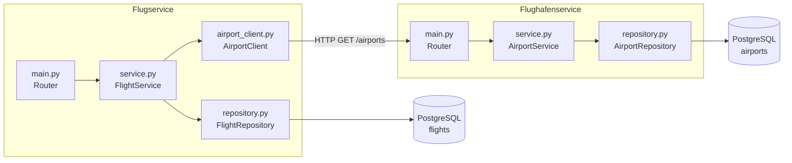
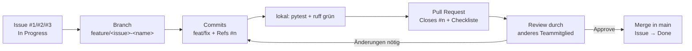

# P2 – Applikation Version 1.0 mit Unit Tests

**Gruppe 1 · M324 DevOps · 23.11.2026 · Issue [#14](https://github.com/SilvanHahnTBZ/M324-devops-gruppenprojekt-G1/issues/14)**

Umgesetzt sind die drei Stories [US-01 #1](https://github.com/SilvanHahnTBZ/M324-devops-gruppenprojekt-G1/issues/1), [US-02 #2](https://github.com/SilvanHahnTBZ/M324-devops-gruppenprojekt-G1/issues/2) und [US-03 #3](https://github.com/SilvanHahnTBZ/M324-devops-gruppenprojekt-G1/issues/3) in zwei getrennten Diensten:

| Dienst | Ordner | Endpoints | README |
|---|---|---|---|
| Flughafenservice | `Code/airport-service` | `POST /airports`, `GET /airports`, `GET /health` | [README](../Code/airport-service/README.md) |
| Flugservice | `Code/flight-service` | `POST /flights`, `GET /health` | [README](../Code/flight-service/README.md) |

Beide Dienste haben die Version `0.1.0`. `1.0.0` vergeben wir erst bei einer stabilen API (Vorschlag aus T3, Entscheid in D2).

---

## 1. Plan vor der Umsetzung

| Thema | Plan |
|---|---|
| **Endpoints** | US-01 `POST /airports` → 201. US-02 `GET /airports` → 200. US-03 `POST /flights` → 201. Dazu `GET /health` für spätere Smoke Tests (P4). |
| **Datenmodell Flughafen** | `id` (UUID, vom Dienst), `name` (2–100 Zeichen), `code` (IATA, genau 3 Buchstaben, eindeutig), `capacity` (ganze Zahl 1–1 000 000 Passagiere/Tag), `created_at` (UTC, vom Dienst) |
| **Datenmodell Flug** | `id`, `departure_airport`, `arrival_airport` (je IATA-Kürzel), `departure_time`, `arrival_time` (ISO 8601 in UTC), `aircraft_type` (2–50 Zeichen), `created_at` |
| **Fehlerfälle** | Siehe Kapitel 3. Einheitliches Fehlerformat `{"detail": "...", "errors": [{"field", "message"}]}` mit deutschen Meldungen. |
| **Tests** | Pro Endpoint Happy Paths und Sad Paths, isoliert ohne Datenbank und ohne zweiten Dienst. Integrationstests gegen eine echte Datenbank und einen E2E-Test über beide Dienste vorbereiten. |

---

## 2. Architektur

Jeder Dienst ist in Schichten aufgebaut. Abhängigkeiten werden in `create_app()` übergeben (Dependency Injection). Darum können die Tests die Datenbank und den Flughafenservice durch einfache Test-Doubles ersetzen.



| Schicht | Aufgabe | Im Unit Test ersetzt durch |
|---|---|---|
| `schemas.py` | Eingabevalidierung (Pydantic): Format, Wertebereich, UTC, Reihenfolge der Zeiten | – (wird mitgetestet) |
| `main.py` | HTTP: Statuscodes, Fehlerantworten | – (TestClient ruft die App direkt auf) |
| `service.py` | Geschäftslogik: ID und Datum erzeugen, Flughäfen prüfen | – |
| `repository.py` | Speicherung | `InMemory…Repository` |
| `airport_client.py` | Aufruf von `GET /airports` | `FakeAirportClient` (simulierter Flughafenservice) |

Wichtige Entscheide:

- **Keine gemeinsame Datenbank.** Jeder Dienst hat eine eigene PostgreSQL-Datenbank (`Code/docker-compose.yml`). Der Flugservice liest Flughäfen nur über `GET /airports` (Vorgabe US-03).
- **Doppelte Kürzel verhindert der `UNIQUE`-Constraint der Datenbank**, nicht eine vorherige Abfrage. So bleibt die Prüfung auch bei zwei gleichzeitigen Anfragen korrekt.
- **Leerer Bestand bei `GET /airports` = 200** mit `count: 0` und Hinweis, nicht 404. Ein leerer Bestand ist ein gültiger Zustand, und der Flugservice kann die Antwort immer gleich auswerten.
- **Zeitangaben müssen UTC sein** (`Z` oder `+00:00`). Andere Zeitzonen weisen wir ab, statt still umzurechnen. Die Story verlangt UTC.
- **Tabellen werden beim Start angelegt** (`create_all`). Ein Migrationstool (z. B. Alembic) ist für v1 noch nicht nötig.

---

## 3. Endpoints und Fehlerfälle

### `POST /airports` (US-01)

| Fall | Antwort |
|---|---|
| Gültig | **201** mit `id` und `created_at` |
| Kürzel schon vorhanden (auch `zrh` statt `ZRH`) | **409** „Das Kürzel 'ZRH' ist bereits erfasst …“ |
| Kapazität 0, negativ, > 1 000 000, Text, Kommazahl, `true` | **422** beim Feld `capacity` |
| Kürzel nicht genau 3 Buchstaben, Name zu kurz, Pflichtfeld fehlt | **422** mit Feld und Meldung |
| Datenbank nicht erreichbar | **503** ohne technische Details |

### `GET /airports` (US-02)

| Fall | Antwort |
|---|---|
| Flughäfen vorhanden | **200** `{"count": n, "items": [...], "message": null}`, sortiert nach Kürzel |
| Keine Flughäfen | **200** `{"count": 0, "items": [], "message": "Es sind noch keine Flughäfen erfasst."}` |
| Datenbankabfrage fehlgeschlagen | **503** „Die Flughäfen konnten nicht geladen werden …“ |

### `POST /flights` (US-03)

| Fall | Antwort |
|---|---|
| Gültig, beide Flughäfen bekannt | **201** |
| Abflug = Ankunft | **422**, Flughafenservice wird gar nicht angefragt |
| Landung gleich oder vor Start | **422** |
| Datum im falschen Format, ohne Zeitzone oder nicht in UTC | **422** beim Zeitfeld |
| Flughafen im Flughafenservice nicht erfasst | **422** „Flughafen 'XXX' ist nicht erfasst.“ |
| Flughafenservice nicht erreichbar oder Antwort fehlerhaft | **503**, es wird nichts gespeichert |

**Ausgewählter Fehlerfall für das Fachgespräch:** Der Flughafenservice ist ausgefallen. Der Flugservice darf den Flug dann **nicht** ungeprüft speichern, sonst landen Flüge zu nicht existierenden Flughäfen in der Datenbank. `HttpAirportClient` übersetzt Netzwerkfehler, HTTP-Fehler und unerwartete Antworten in `AirportServiceUnavailableError`. Der Endpoint antwortet mit 503. Abgesichert durch `test_create_flight_returns_503_when_airport_service_is_down` und `test_get_airport_codes_raises_when_service_unreachable`.

---

## 4. Unit Tests

### Dokumentation im JavaDoc-Stil

P2 verlangt JavaDoc-Syntax. In Python schreiben wir die Testbeschreibung als Docstring mit JavaDoc-Tags:

```python
def test_create_airport_rejects_duplicate_code_with_409(client, valid_airport):
    """
    Sad Path: Ein Kürzel darf nur einmal vorkommen.

    Given ein bereits erfasster Flughafen mit Kürzel ZRH
    When ein zweiter Flughafen mit Kürzel "zrh" erfasst wird
    Then antwortet der Dienst mit 409 und nennt das doppelte Kürzel.

    @param client        Testclient mit leerem In-Memory-Repository
    @param valid_airport gültige Eingabedaten
    @expected HTTP 409, Fehlermeldung enthält "ZRH"
    """
```

| Element | Bedeutung |
|---|---|
| Erste Zeile | `Happy Path` oder `Sad Path` und was geprüft wird |
| Given / When / Then | Ausgangslage, Aktion, erwartetes Ergebnis |
| `@param` | jede verwendete Fixture oder jeder Parameter |
| `@expected` | konkret geprüftes Resultat (Statuscode, Felder) |
| `@throws` | erwartete Exception (bei Tests ohne HTTP) |
| `@see`, `@since` | im Modul-Docstring: Link zur Story und Version |

### Übersicht pro Endpoint

Parametrisierte Tests zählen pro Datensatz als eigener Testfall.

| Endpoint | Testdatei | Testfunktionen | Testfälle | Happy | Sad |
|---|---|---|---|---|---|
| `POST /airports` | `airport-service/tests/unit/test_create_airport.py` | 8 | 16 | 3 | 13 |
| `GET /airports` | `airport-service/tests/unit/test_list_airports.py` | 5 | 5 | 3 | 2 |
| `POST /flights` | `flight-service/tests/unit/test_create_flight.py` | 7 | 12 | 2 | 10 |
| ↳ Client für `GET /airports` | `flight-service/tests/unit/test_airport_client.py` | 4 | 6 | 2 | 4 |

### Isolation

- Keine Datenbank: `InMemoryAirportRepository` und `InMemoryFlightRepository`.
- Kein zweiter Dienst: `FakeAirportClient` liefert feste Kürzel, kann „nicht erreichbar“ simulieren und zählt die Aufrufe.
- Kein Netzwerk: `httpx.MockTransport` liefert vorbereitete HTTP-Antworten an `HttpAirportClient`.
- Feste Werte: `AirportService` bekommt Uhr und ID-Generator übergeben (`test_service_sets_id_and_creation_date_from_injected_factories`).
- Jeder Test bekommt frische Fixtures, die Tests hängen nicht voneinander ab.

### Testergebnis (lokal, 23.11.2026, Python 3.11.9, pytest 9.2.0)

```text
Code/airport-service  $ pytest -v
23 passed in 0.27s      (21 Unit, 2 Integration gegen SQLite)

Code/flight-service   $ pytest -v
19 passed in 0.17s      (18 Unit, 1 Integration gegen SQLite)

Code/e2e (beide Dienste mit uvicorn gestartet)
1 passed in 1.02s
```

Lint mit `ruff check` und `ruff format --check`: keine Befunde.

### Grenzen der Tests

| Grenze | Folge | Wie wir sie schliessen |
|---|---|---|
| Unit Tests verwenden keine echte PostgreSQL-Datenbank | Ein Fehler im SQL oder im `UNIQUE`-Constraint fällt dort nicht auf | Integrationstests in `tests/integration`, in P3 gegen PostgreSQL |
| `FakeAirportClient` gibt vor, wie der Flughafenservice antwortet | Ändert der Flughafenservice sein Antwortformat, bleiben die Unit Tests grün | E2E-Test über beide Dienste in der CI (P3) |
| Test mit 1000 Flughäfen prüft Korrektheit, nicht Geschwindigkeit | „ohne Verzögerung“ ist nicht gemessen | Lasttest wäre ein späterer Schritt |
| Pydantic prüft „Abflug = Ankunft“ erst, wenn die Felder einzeln gültig sind | Bei mehreren Fehlern gleichzeitig erscheint nicht jede Meldung sofort | bewusst akzeptiert |
| Kein Test für gleichzeitige Anfragen mit demselben Kürzel | Race Condition nur durch Datenbank-Constraint abgesichert | Integrationstest gegen PostgreSQL |

Gefundener Fehler: Im lokalen E2E-Lauf mit SQLite fehlte bei `created_at` die Zeitzone. Behoben in `feature/2-flughaefen-auslesen` (Commit „fix(airport)…“), mit Regressionstest im Integrationstest.

---

## 5. Integrationstests (Plan für P3)

| Stufe | Was | Stand |
|---|---|---|
| Repository ↔ Datenbank | `tests/integration/test_sql_repository.py` in beiden Diensten. Mit `TEST_DATABASE_URL` gegen PostgreSQL, sonst SQLite. | umgesetzt, lokal mit SQLite grün |
| Flugservice ↔ Flughafenservice | `Code/e2e/test_flight_booking_e2e.py` über die echten HTTP-Endpoints | umgesetzt, lokal mit uvicorn grün; wird ohne `E2E_*`-Variablen übersprungen |
| CI | P3: Lint → Unit → Integration mit PostgreSQL-Service-Container → E2E mit `docker compose` | geplant (#15) |

`Code/docker-compose.yml` startet beide Datenbanken und beide Dienste. Docker lief beim lokalen Test nicht, deshalb sind Compose und Dockerfiles noch ungetestet. Das prüfen wir spätestens in P3.

---

## 6. Ablauf Branch → Review → Integration



| Branch | Story | Basis |
|---|---|---|
| `feature/1-flughafen-erfassen` | US-01 | `main` |
| `feature/2-flughaefen-auslesen` | US-02 | baut auf US-01 auf, wird **nach** US-01 gemergt |
| `feature/3-flug-erfassen` | US-03 | `main` (eigener Dienst, unabhängig) |
| `docs/14-p2-applikation-v1` | diese Doku | `main` |

**Review-Checkliste im PR** (gilt, bis D3 den Review-Prozess verbindlich festlegt):

1. Abnahmekriterien der Story erfüllt?
2. Tests lokal ausgeführt und grün (`pytest -v`, `ruff check .`)?
3. Pro Endpoint Happy und Sad Paths, Docstrings im JavaDoc-Stil?
4. Keine Secrets im Code, keine Datenbankzugriffe auf den anderen Dienst?
5. Kann die reviewende Person den Code im Fachgespräch erklären?

Warum so: Kleine Branches pro Story landen schnell in `main` (CI-Gedanke aus T3). Das Review durch eine andere Person verteilt das Wissen, und ein roter Test verhindert den Merge. Sobald P3 läuft, prüft zusätzlich die Pipeline jeden PR.

> **Offen:** D2 (#6, Branching und SemVer) und D3 (#7, Meetings und Review-Prozess) sind noch nicht verbindlich dokumentiert. P2 verlangt, dass die D3-Prozesse vorher definiert sind. Das Team muss D2/D3 festhalten und die Checkliste oben dort übernehmen oder anpassen.

---

## 7. Vorbereitung Fachgespräch FG2 (Woche 5)

| Frage | Kurzantwort (in eigenen Worten üben) |
|---|---|
| Einen Endpoint erklären | `POST /flights`: Pydantic prüft das Format → Service holt die Kürzel über `GET /airports` → unbekannt = 422, Dienst down = 503 → sonst speichern, 201. |
| Relevanter Fehlerfall | Flughafenservice nicht erreichbar → 503, nichts wird gespeichert (Kapitel 3). |
| Was prüfen die Tests? | Statuscode, Fehlerfeld und Meldung, dass nichts gespeichert wurde und ob der Flughafenservice aufgerufen wurde (`calls`). |
| Grenzen der Tests | Fake statt echtem Dienst, keine echte DB in Unit Tests, keine Lastmessung (Kapitel 4). |
| Branch, Review, Integration | Kapitel 6. |

---

## KI-Nachweis

| | |
|---|---|
| **Auftrag** | P2 – Applikation v1 (#14), US-01 bis US-03 |
| **KI-Tool** | Claude (Anthropic) in Claude Code |
| **Zweck** | Co-Pilot für Code und Tests, Testideen, Review der Fehlerfälle |
| **Eigener Startplan ohne KI** | Abnahmekriterien und geplante Testfälle in den Issues #1–#3 (vom Team in P1 erfasst), Technologieentscheid aus P1 |
| **Promptauszug** | „P2 umsetzen: Repo `M324-devops-gruppenprojekt-G1`, drei User Stories mit Unit Tests (Happy und Sad Paths), isoliert, JavaDoc-Syntax, KI-Nachweis.“ |
| **Wichtigste KI-Antwort** | Schichtenarchitektur mit Repository-Schnittstelle und `AirportClient`-Schnittstelle, damit Datenbank und Flughafenservice in Unit Tests ersetzt werden können. |
| **Übernommene Vorschläge** | Schichten und `create_app(repository, airport_client)`, einheitliches Fehlerformat, 409 bei doppeltem Kürzel, 503 bei ausgefallenem Flughafenservice |
| **Angepasste oder verworfene Vorschläge** | `Depends(...)` als Standardwert nach Lint-Befund (ruff B008) auf `Annotated` umgestellt; Ausgabeschemas um `from_attributes` ergänzt; Lesen von `created_at` auf UTC korrigiert |
| **Validierung** | Alle Tests lokal ausgeführt (Kapitel 4). Lokaler E2E-Lauf mit beiden Diensten. |
| **Resultat und Korrektur** | Der E2E-Lauf deckte einen Fehler auf, den die Unit Tests nicht fanden: `created_at` ohne Zeitzone bei SQLite. Behoben, Regressionstest ergänzt. Ausserdem schlugen 3 Tests zuerst fehl (`from_attributes` fehlte), danach Korrektur. |
| **Eigenleistung** | Auftrag, Stories, Stack und Ablauf vorgegeben (P1, Issues); Prüfung der Pull Requests und Merge-Entscheid durch Silvan |
