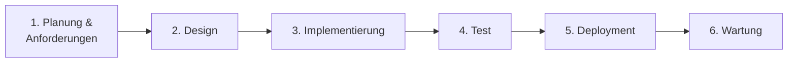
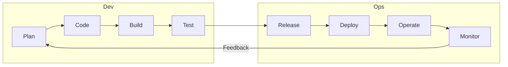
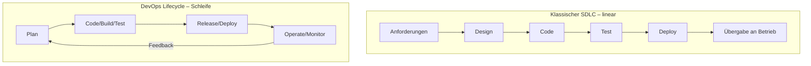
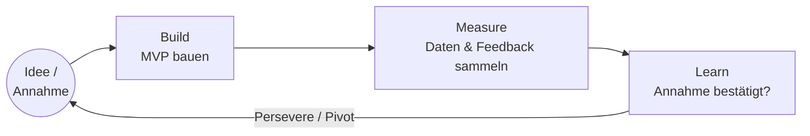
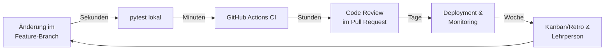

# T2 – DevOps Prozesse: SDLC, DevOps Lifecycle und MVP

**Name:** Silvan Hahn  
**Modul:** M324 – DevOps  
**Auftrag:** [T2 Theorie DevOps Prozesse](https://gitlab.com/ch-tbz-it/Stud/m324/-/blob/main/Projekt/T2_Theorie_DevOps_Prozesse.md)  
**Issue:** [#11 – T2 SDLC, DevOps Lifecycle und MVP vergleichen](https://github.com/SilvanHahnTBZ/M324-devops-gruppenprojekt-G1/issues/11)

---

## Inhalt

1. [Was ist der SDLC?](#1-was-ist-der-sdlc-software-development-life-cycle)
2. [Was ist der DevOps Lifecycle?](#2-was-ist-der-devops-lifecycle)
3. [Unterschiede SDLC und DevOps Lifecycle](#3-unterschiede-zwischen-sdlc-und-devops-lifecycle)
4. [Was ist ein MVP?](#4-was-ist-ein-mvp-minimum-viable-product)
5. [Transfer: Feedbackschleifen in unserem Flughafenprojekt](#5-transfer-feedbackschleifen-in-unserem-flughafenprojekt)
6. [Quellenvergleich](#6-quellenvergleich)
7. [KI-Nachweis](#ki-nachweis)
8. [Quellen](#quellen)

---

## 1. Was ist der SDLC (Software Development Life Cycle)?

### Definition

Der SDLC beschreibt den **Weg einer Software von der Idee bis zur Wartung** als Abfolge von klar getrennten Phasen. AWS beschreibt ihn als kosten- und zeiteffizienten Prozess, mit dem Teams qualitativ hochwertige Software planen und bauen. Das zentrale Ziel ist laut AWS, Projektrisiken durch vorausschauende Planung zu senken [1]. Wikipedia spricht im deutschen Raum eher von einem **Vorgehensmodell**: einem standardisierten organisatorischen Rahmen, der ein Projekt in überschaubare, zeitlich und inhaltlich begrenzte Phasen teilt, damit Komplexität, Zeit, Kosten, Risiko und Qualität steuerbar bleiben [2].

**In eigenen Worten:** Der SDLC ist ein Fahrplan. Er sagt, *was* in welcher Reihenfolge erledigt werden muss, damit am Ende eine funktionierende Software entsteht – und wer wann was abliefert.

### Die Phasen

Die Anzahl und die Namen der Phasen sind je nach Quelle unterschiedlich (siehe [Quellenvergleich](#6-quellenvergleich)). AWS nennt sechs Phasen [1], viele andere Quellen trennen zusätzlich die Anforderungsanalyse von der Planung [3].

| Phase | Was passiert? | Beitrag zur Software | Typisches Ergebnis |
|-------|---------------|----------------------|--------------------|
| **1. Planung & Anforderungen** | Kosten-Nutzen-Analyse, Zeitplan, Ressourcen schätzen; Anforderungen mit Kunden und Stakeholdern erheben | Klärt, *was* gebaut werden soll und ob es sich lohnt | Projektplan, Anforderungsdokument (Lastenheft/Pflichtenheft) |
| **2. Design** | Architektur, Schnittstellen, Datenmodell und Technologien festlegen | Legt fest, *wie* die Anforderungen technisch umgesetzt werden | Architektur- und Designdokument |
| **3. Implementierung** | Entwickler schreiben den Code nach dem Design | Die Software entsteht | Quellcode, lauffähige Komponenten |
| **4. Test** | Unit-, Integrations-, System- und Abnahmetests; Fehler werden gemeldet und behoben | Prüft, ob die Software die Anforderungen erfüllt | Testprotokolle, behobene Fehler |
| **5. Deployment** | Software wird in die Produktionsumgebung gebracht und den Benutzern übergeben | Die Software kommt beim Kunden an | Release in Produktion |
| **6. Wartung** | Fehler beheben, Updates einspielen, kleine Anpassungen | Software bleibt nutzbar und sicher | Patches, neue Versionen |

### Vorgehensmodelle: Wie der SDLC angewendet wird

Der SDLC sagt *welche* Phasen es gibt. Ein **Vorgehensmodell** legt fest, *in welcher Reihenfolge und wie oft* sie durchlaufen werden [1][2]:

| Modell | Ablauf | Geeignet für |
|--------|--------|--------------|
| **Wasserfall** | Phasen strikt nacheinander, jede Phase muss abgeschlossen sein, bevor die nächste beginnt. Wenig Raum für Änderungen. | Kleine Projekte mit festen, klaren Anforderungen |
| **V-Modell** | Wie Wasserfall, aber zu jeder Entwicklungsphase gibt es eine passende Testphase (z. B. Anforderungen ↔ Abnahmetest) | Sicherheitskritische Systeme, Behördenprojekte |
| **Iterativ** | Man startet mit einem Teil der Anforderungen und erweitert die Software in mehreren Versionen | Projekte, bei denen nicht alles von Anfang an klar ist |
| **Spiral** | Iterationen mit starkem Fokus auf Risikoanalyse in jeder Runde | Grosse, komplexe, risikoreiche Projekte |
| **Agil (z. B. Scrum)** | Alle Phasen werden in kurzen Zyklen (Sprints) immer wieder durchlaufen, mit kleinen Inkrementen | Projekte mit sich ändernden Anforderungen |

### Steuerung im Projekt

Typisch für den klassischen SDLC ist die Steuerung über **Meilensteine und Phasenübergänge** (Quality Gates): Am Ende jeder Phase wird ein Dokument abgenommen (z. B. das Pflichtenheft), erst dann wird die nächste Phase freigegeben. Ein Projektleiter überwacht Zeit, Kosten und Umfang. Wikipedia betont aber, dass ein Vorgehensmodell ein **Mittel und kein Selbstzweck** ist – es muss zum Projekt passen [2].

**Beispiel:** Eine Bank lässt eine neue Kontoverwaltung nach Wasserfall bauen. Zuerst werden während drei Monaten alle Anforderungen erhoben und unterschrieben. Danach folgen Design, Entwicklung und eine lange Testphase. Nach 12 Monaten geht die Software live und wird an das Betriebsteam übergeben. Stellt sich erst dann heraus, dass Kunden eine Funktion anders brauchen, ist die Änderung teuer.

---

## 2. Was ist der DevOps Lifecycle?

### Definition

Der DevOps Lifecycle beschreibt die Entwicklung und den Betrieb von Software als **endlose Schleife** statt als Linie. IBM beschreibt ihn als kontinuierlichen, iterativen Prozess aus acht Phasen, dargestellt als Unendlichkeitsschleife [4]. Microsoft nennt vier Phasen (Planen, Entwickeln, Bereitstellen, Betreiben) und betont, dass die Phasen nicht an Rollen gebunden sind und aufeinander aufbauen [5]. Laut GitLab ist das Ziel von DevOps, Geschwindigkeit und Qualität der Softwareauslieferung zu erhöhen – durch Zusammenarbeit, gemeinsame Verantwortung und kontinuierliche Verbesserung [6].

**In eigenen Worten:** Beim DevOps Lifecycle ist die Software nach dem Release nicht „fertig“. Der Betrieb und das Monitoring liefern Rückmeldungen, die direkt wieder in die nächste Planung einfliessen. Entwicklung (Dev) und Betrieb (Ops) arbeiten in *einer* Schleife zusammen statt in zwei getrennten Abteilungen.

### Die Kernphasen (8-Phasen-Modell nach IBM)

*Die Schleife: Was im Monitoring auffällt, wird zur Anforderung in der nächsten Planung.*

| Phase | Was passiert? | Typische Tools |
|-------|---------------|----------------|
| **Plan** | Anforderungen als kleine User Stories im Backlog, Priorisierung, Sprint- oder Kanban-Planung | GitHub Projects, Jira |
| **Code** | Entwicklung in kleinen Änderungen, Versionsverwaltung, Code Reviews über Pull Requests | Git, GitHub, IDE |
| **Build** | Code wird automatisch kompiliert bzw. paketiert (z. B. Container-Image) | GitHub Actions, Docker |
| **Test** | Automatisierte Tests laufen bei jeder Änderung (Continuous Integration) | pytest, JUnit |
| **Release** | Ein getestetes, versioniertes Artefakt wird für die Auslieferung freigegeben | GitHub Releases, Container Registry |
| **Deploy** | Automatische Auslieferung in Test- und Produktionsumgebung (Continuous Delivery/Deployment) | GitHub Actions, Kubernetes |
| **Operate** | Betrieb der Anwendung, Skalierung, Infrastruktur als Code | Cloud-Plattform, Terraform |
| **Monitor** | Logs, Metriken, Alarme und Kundenfeedback sammeln – das ist der Input für die nächste Planung | Prometheus, Grafana, Datadog |

IBM ergänzt, dass Sicherheit oft als „neunte Phase“ (DevSecOps) bezeichnet wird, weil sie in der Schleife nicht explizit vorkommt, aber in jede Phase gehört [4]. GitLab baut Sicherheit (*Secure*) und *Govern* deshalb direkt als eigene Stufen ein [6].

### Die „7 Cs“ – Kontinuität als Prinzip

IBM beschreibt den DevOps Lifecycle zusätzlich über sieben kontinuierliche Praktiken: Continuous Development, Integration, Testing, Delivery/Deployment, Feedback, Monitoring und Operations [4]. Das zeigt: Im DevOps Lifecycle sind die Phasen keine einmaligen Schritte, sondern **laufen gleichzeitig und dauernd** ab.

### Ziele im Vergleich zu traditionellen Ansätzen

| Ziel | Bedeutung | Quelle |
|------|-----------|--------|
| Kürzere Time-to-Market / Lead Time | Änderungen kommen in Tagen statt Monaten zum Kunden | [4][5] |
| Höhere Qualität | Fehler werden durch automatisierte Tests früh erkannt | [4][6] |
| Stabilität und Zuverlässigkeit | Kleine Änderungen sind weniger riskant; schnelle Wiederherstellung (tiefe MTTR) | [5] |
| Zusammenarbeit statt Silos | Arbeit wird geteilt statt zwischen Abteilungen übergeben | [4][7] |
| Kontinuierliche Verbesserung | Feedback aus dem Betrieb fliesst laufend zurück | [6][8] |

Der Bezug zu T1: Die Schleife ist eine direkte Umsetzung von **The Three Ways** – der Weg von Plan bis Deploy ist der *First Way* (Flow), der Pfeil von Monitor zurück zu Plan ist der *Second Way* (Feedback), und das wiederholte Durchlaufen mit Verbesserungen ist der *Third Way* (Lernen) [8].

---

## 3. Unterschiede zwischen SDLC und DevOps Lifecycle

### Wichtige Vorbemerkung

Die Quellen grenzen die beiden Begriffe nicht ganz gleich ab. AWS zählt Agile ausdrücklich als **ein SDLC-Modell** auf [1]. Der SDLC ist also eigentlich der Oberbegriff für *jeden* Entwicklungsprozess. Wenn man SDLC und DevOps vergleicht, vergleicht man in der Praxis meist den **klassischen, sequenziellen SDLC (Wasserfall)** mit dem DevOps Lifecycle. So mache ich es in diesem Kapitel. Man kann DevOps auch als Weiterentwicklung des SDLC sehen, die den Betrieb in die Schleife holt.

### Gegenüberstellung

| Kriterium | Klassischer SDLC | DevOps Lifecycle |
|-----------|------------------|------------------|
| **Form** | Linear, Phase nach Phase | Unendliche Schleife |
| **Release-Rhythmus** | Selten, grosse Releases (Monate) | Häufig, kleine Releases (Tage/Wochen) |
| **Anforderungen** | Am Anfang vollständig festgelegt | Laufend angepasst, priorisiert im Backlog |
| **Teams** | Getrennt: Entwicklung übergibt an Test, Test an Betrieb | Gemeinsames Team mit geteilter Verantwortung |
| **Testen** | Eigene Phase gegen Ende | Automatisiert in jeder Änderung (CI) |
| **Deployment** | Manuell, einmaliges Grossereignis | Automatisiert über Pipeline (CD) |
| **Betrieb** | Letzte Phase, „nach“ dem Projekt | Fester Teil der Schleife |
| **Feedback** | Spät, oft erst nach dem Go-Live | Früh und laufend (Tests, Monitoring, Benutzer) |
| **Steuerung** | Meilensteine, Dokumente, Phasenabnahmen | Metriken (Lead Time, Deployment-Frequenz, MTTR), Kanban |
| **Hauptziel** | Risiko durch Planung senken [1] | Geschwindigkeit *und* Qualität durch Automation und Feedback [6] |

### Auswirkungen auf Entwicklung, Bereitstellung und Betrieb

**Entwicklung:** Im klassischen SDLC programmieren Entwickler lange an einem grossen Paket und erfahren erst in der Testphase, ob es funktioniert. Im DevOps Lifecycle werden kleine Änderungen sofort automatisch getestet. Fehler sind dadurch schneller gefunden und billiger zu beheben (Second Way, siehe T1).

**Bereitstellung:** Ein grosses Wasserfall-Release ist riskant, weil viele Änderungen gleichzeitig live gehen – geht etwas schief, ist die Ursache schwer zu finden. Bei DevOps sind die Releases klein und automatisiert, ein Rollback ist einfacher.

**Betrieb:** Beim klassischen SDLC bekommt das Betriebsteam eine fertige Software „über den Zaun geworfen“ und muss sie betreiben, ohne sie gebaut zu haben. Bei DevOps trägt das Team die Verantwortung bis in den Betrieb mit; Monitoring-Daten fliessen direkt in die Weiterentwicklung.

### Warum Feedback, Betrieb und Verbesserung bei DevOps stärker integriert sind

Im klassischen SDLC ist Wartung die **letzte** Phase – danach ist das Projekt abgeschlossen. Das Wissen aus dem Betrieb kommt beim nächsten Projekt, wenn überhaupt, erst Monate später an. Im DevOps Lifecycle ist **Monitor direkt mit Plan verbunden**. Jede Erkenntnis aus dem Betrieb (Fehler, Performance, Benutzerverhalten) wird zu einem neuen Backlog-Eintrag. Weil die Schleife oft durchlaufen wird, wird die Software in vielen kleinen Schritten besser. Das entspricht dem Lean-Gedanken der kontinuierlichen Verbesserung aus CALMS [7].

### Eigene Einschätzung

Der klassische SDLC ist nicht „falsch“. Bei einem Projekt mit festen Anforderungen und hohen Regulierungsauflagen (z. B. Medizinaltechnik) kann ein geplanter, dokumentierter Ablauf sinnvoll sein. Für Software, die laufend weiterentwickelt und betrieben wird – wie unsere Flughafen-API – passt der DevOps Lifecycle besser, weil Anforderungen sich ändern und schnelles Feedback wichtiger ist als ein perfekter Plan am Anfang.

---

## 4. Was ist ein MVP (Minimum Viable Product)?

### Definition

Der Begriff stammt von **Frank Robinson (2001)** und wurde durch **Eric Ries** mit dem Buch *The Lean Startup* bekannt [9][10]. Ries definiert das MVP als die Version eines neuen Produkts, mit der ein Team mit dem **geringsten Aufwand das meiste validierte Wissen über die Kunden** sammeln kann [11]. Wikipedia beschreibt es als die erste minimal funktionsfähige Iteration eines Produkts, mit der man schnell aus dem Feedback früher Benutzer lernt [10].

**In eigenen Worten:** Ein MVP ist nicht einfach „die kleinste Version“ eines Produkts, sondern ein **Experiment**. Man baut gerade so viel, dass echte Benutzer es verwenden können, und prüft damit eine Annahme: Brauchen die Leute das wirklich so?

### Kernmerkmale

| Merkmal | Erklärung |
|---------|-----------|
| **Minimum** | Nur die Funktionen, die nötig sind, um die wichtigste Annahme zu testen |
| **Viable (funktionsfähig)** | Es muss für echte Benutzer funktionieren und einen Nutzen bringen – kein reiner Prototyp ohne Wert |
| **Lerninstrument** | Ziel ist validiertes Lernen, nicht ein fertiges Produkt [11] |
| **Messbar** | Vorher wird festgelegt, woran man Erfolg erkennt (z. B. Anzahl Benutzer, Fehlerrate) |
| **Iterativ** | Nach der Auswertung folgt die Entscheidung: weitermachen (*persevere*) oder Richtung ändern (*pivot*) |

### Der Build-Measure-Learn-Zyklus

### Häufiges Missverständnis

Ries betont ausdrücklich, dass es beim MVP **nicht darum geht, möglichst minimale Produkte zu bauen**, und dass es kein festes Rezept gibt, sondern Urteilsvermögen braucht [11]. Ein MVP ist also nicht „halbfertige Software“. Ein MVP kann sogar ganz ohne Code auskommen: Dropbox testete die Nachfrage zuerst mit einem Erklärvideo, Buffer mit einer einfachen Landingpage [9].

**Abgrenzung:** Manche Quellen unterscheiden das MVP vom **MMP (Minimum Marketable Product)** – dem ersten Produkt, das man tatsächlich verkaufen kann. Andere verwenden die Begriffe gleichbedeutend [10].

### Rolle des MVP im DevOps Lifecycle

Der Build-Measure-Learn-Zyklus und der DevOps Lifecycle haben dieselbe Form: eine Schleife mit Feedback. DevOps liefert die **technische Grundlage**, damit ein MVP schnell gebaut, ausgeliefert und gemessen werden kann.

| DevOps-Phase | Rolle des MVP |
|--------------|---------------|
| **Plan** | Die wichtigste Annahme wird als kleiner Umfang (wenige User Stories) festgelegt. Alles andere kommt ins Backlog. |
| **Code / Build / Test** | Nur der MVP-Umfang wird gebaut. Automatisierte Tests stellen sicher, dass er trotz kleinem Umfang funktioniert („viable“). |
| **Release / Deploy** | Dank CI/CD-Pipeline kommt das MVP schnell zu echten Benutzern statt erst nach Monaten. |
| **Operate / Monitor** | Hier passiert das *Measure*: Logs, Metriken und Benutzerfeedback zeigen, ob die Annahme stimmt. |
| **zurück zu Plan** | Das *Learn*: Die Erkenntnisse bestimmen das nächste Inkrement – Feature ausbauen, ändern oder streichen. |

**Warum das zusammenpasst:** Ohne DevOps wäre jeder Durchlauf des Build-Measure-Learn-Zyklus langsam, weil Tests und Deployments manuell sind. Mit einer Pipeline kann man dagegen mehrmals pro Woche eine neue Version ausliefern und aus echtem Feedback lernen. Umgekehrt gibt das MVP dem DevOps-Team eine Richtung: Es wird zuerst gebaut, was den grössten Lerneffekt hat, statt alles auf einmal (Lean: kein Waste durch Features, die niemand braucht).

---

## 5. Transfer: Feedbackschleifen in unserem Flughafenprojekt

Unser Gruppenprojekt ist ein Backend für die Flughafen- und Flugverwaltung mit zwei Mikroservices (siehe [P1](../Dokumentation/P1-Projekt-und-Infrastruktur.md)).

### Unser MVP

Das MVP ist die **Version 1 aus P2** mit den drei User Stories:

- [US-01 – Flughafen erfassen](https://github.com/SilvanHahnTBZ/M324-devops-gruppenprojekt-G1/issues/1)
- [US-02 – Alle Flughäfen auslesen](https://github.com/SilvanHahnTBZ/M324-devops-gruppenprojekt-G1/issues/2)
- [US-03 – Flug erfassen](https://github.com/SilvanHahnTBZ/M324-devops-gruppenprojekt-G1/issues/3)

**Annahme, die wir damit prüfen:** Die zwei Dienste können getrennt laufen und der Flugservice kann Abflug- und Zielflughafen zuverlässig über die API des Flughafenservice prüfen. Funktionen wie Flüge bearbeiten, Suche oder Authentifizierung lassen wir bewusst weg – sie sind für diese Annahme nicht nötig.

### Unser Lifecycle

| DevOps-Phase | Bei uns | Auftrag |
|--------------|---------|---------|
| Plan | User Stories und Aufgaben im Kanban-Board (Todo → In Progress → Review → Done) | D1, D3 |
| Code | Feature-Branches, Pull Requests mit Review | D2 |
| Build / Test | pytest-Unit-Tests, später automatisch in GitHub Actions | P2, P3 |
| Release | Versionierte Build-Artefakte mit Semantic Versioning | P3b, D2 |
| Deploy | Automatisiertes Deployment mit Rollback | P4 |
| Operate / Monitor | Monitoring und zentrale Logs (Zusatz) | Z3 |
| Feedback → Plan | Erkenntnisse werden neue Issues im Backlog | laufend |

### Geplante Feedbackschleifen

| Schleife | Wer gibt Feedback? | Wie schnell? | Was lernen wir? |
|----------|--------------------|--------------|-----------------|
| 1. Unit-Tests lokal | pytest | Sekunden | Funktioniert meine Änderung? |
| 2. CI-Pipeline | GitHub Actions | Minuten | Funktioniert sie auch zusammen mit dem Rest? |
| 3. Code Review | Teammitglied im Pull Request | Stunden | Ist der Code verständlich und richtig? |
| 4. Deployment & Monitoring | Logs, Fehlerraten | Tage | Läuft der Dienst stabil, ist die Flughafen-API erreichbar? |
| 5. Kanban-Review / Fachgespräch | Team und Lehrperson | Woche | Bauen wir das Richtige, wo bremst unser Prozess? |

**Zusammenhang Anforderungen → Entwicklung → Betrieb → Feedback:** Eine Anforderung (User Story) wird im Board geplant, in einem Branch entwickelt, durch Tests und Review geprüft und über die Pipeline ausgeliefert. Was im Betrieb oder im Review auffällt, wird ein neues Issue – und damit wieder eine Anforderung. Je kürzer eine Schleife, desto billiger ist ein Fehler. Darum wollen wir möglichst viel über die schnellen Schleifen 1 und 2 abfangen.

---

## 6. Quellenvergleich

Die Quellen stimmen in der Grundidee überein, unterscheiden sich aber in Details. Wo sie sich widersprochen haben, habe ich weitere Quellen beigezogen.

| Thema | Unterschied zwischen den Quellen | Meine Schlussfolgerung |
|-------|----------------------------------|------------------------|
| Anzahl SDLC-Phasen | AWS: 6 Phasen [1]. Andere Quellen: 7, mit separater Anforderungsanalyse [3]. Wikipedia: keine feste Zahl, je nach Vorgehensmodell [2]. | Die Zahl ist nicht entscheidend. Alle Modelle decken Planen, Entwerfen, Bauen, Testen, Ausliefern und Warten ab. |
| Anzahl DevOps-Phasen | Microsoft: 4 [5]. IBM: 8 [4]. GitLab: 9 (inkl. Secure und Govern) [6]. | Es gibt kein „offizielles“ Modell. Ich verwende die 8 Phasen von IBM, weil sie am feinsten sind und am häufigsten vorkommen. Wichtig ist bei allen die Schleife von Monitor zurück zu Plan. |
| Ist Agile ein SDLC? | AWS zählt Agile als SDLC-Modell [1]. Viele Vergleichsartikel setzen „SDLC“ mit Wasserfall gleich. | Der SDLC ist der Oberbegriff. Der Vergleich in Kapitel 3 bezieht sich auf den klassischen, sequenziellen SDLC. |
| Was „minimal“ beim MVP heisst | Wikipedia: „minimal funktionsfähige Iteration“ [10]. Ries: es geht *nicht* um minimale Produkte, sondern ums Lernen [11]. | Ich folge Ries als Urheber der bekannten Definition: Das MVP wird am Lerneffekt gemessen, nicht an der Anzahl Features. |
| Herkunft MVP | Productboard und Wikipedia nennen Frank Robinson (2001) als Urheber [9][10]; im Alltag wird oft nur Ries genannt. | Robinson hat den Begriff geprägt, Ries hat ihn bekannt gemacht und mit Build-Measure-Learn verbunden. |

---

## KI-Nachweis

| | |
|---|---|
| **Eingesetztes Tool** | Claude (Anthropic) in Claude Code |
| **Wofür** | Quellensuche und Abgleich der Quellen, Entwurf der Kapitel 1–4 und 6, Diagramme (Mermaid), Struktur des Transfers |
| **Prompt (Auszug)** | „Machen wir T2 miteinander gleich wie letztes Mal.“ (Auftrag T2 eingefügt) |
| **KI-Hinweis (ausgewählt)** | Die KI hat zuerst „den“ DevOps Lifecycle mit 8 Phasen als feste Definition dargestellt. |
| **Geprüft mit** | IBM [4] nennt 8 Phasen, Microsoft [5] aber nur 4 und GitLab [6] 9. Die Aussage stimmt also nur für IBM. |
| **Korrektur** | Im Dokument steht jetzt, dass es kein einheitliches Modell gibt und welche Quelle welche Phasen nennt (Kapitel 2 und 6). |
| **Zweiter geprüfter Punkt** | Die verbreitete Aussage „MVP = kleinste mögliche Version“ wurde mit dem Originaltext von Eric Ries [11] verglichen: Ries widerspricht dem ausdrücklich. Kapitel 4 wurde entsprechend formuliert. |
| **Eigener Anteil** | Zusammenfassung der Kapitel 1–5 gelesen und die Verständnisfragen der KI ohne Unterlagen selbst beantwortet (siehe unten). |
| **Verständnisprüfung** | Die KI hat mir 5 Fragen ohne Unterlagen gestellt. **Richtig:** SDLC ist linear, der DevOps Lifecycle eine Schleife mit vielen kleinen statt wenigen grossen Releases. Unser MVP sind US-01 bis US-03, die schnellste Feedbackschleife ist pytest lokal. **Teilweise richtig:** SDLC als Fahrplan von der Idee bis zur Wartung mit Vorgehensmodellen (Wasserfall, V-Modell, agil) erklärt, aber die Phasen nicht genannt (Planung/Anforderungen, Design, Implementierung, Test, Deployment, Wartung). Die Verbindung Monitor → Plan richtig mit neuem Wissen für die Planung begründet; ergänzt wurde, dass daraus konkrete Backlog-Einträge entstehen (Second/Third Way aus T1). **Korrigiert:** Ich habe das MVP zuerst als „einfach die kleinste Version“ beschrieben. Laut Ries [11] geht es nicht um ein minimales Produkt, sondern um ein Experiment zum Lernen. Diese Punkte wiederhole ich vor dem Fachgespräch. |
| **Eigene Schlussfolgerung** | Am meisten mitgenommen habe ich, dass ein MVP ein Experiment ist und nicht einfach eine möglichst kleine Version des Produkts. Wichtig ist, was man damit über die Benutzer lernt. |

---

## Quellen

Alle Quellen abgerufen am 16.11.2026.

1. AWS: *What is SDLC? – Software Development Lifecycle Explained*. <https://aws.amazon.com/what-is/sdlc/>
2. Wikipedia: *Vorgehensmodell zur Softwareentwicklung*. <https://de.wikipedia.org/wiki/Vorgehensmodell_zur_Softwareentwicklung>
3. Snyk: *Software Development Life Cycle (SDLC)*. <https://snyk.io/de/articles/sdlc-software-development-life-cycle/>
4. IBM: *What is the DevOps lifecycle?* <https://www.ibm.com/think/topics/devops-lifecycle>
5. Microsoft Learn: *Was ist DevOps?* <https://learn.microsoft.com/de-de/devops/what-is-devops>
6. GitLab: *What is DevOps?* <https://about.gitlab.com/topics/devops/>
7. TBZ M324: *CALMS* und *DevOps Einführung*. <https://gitlab.com/ch-tbz-it/Stud/m324/-/blob/main/Kultur/CALMS.md>, <https://gitlab.com/ch-tbz-it/Stud/m324/-/blob/main/Kultur/DevOpsEinfuehrung.md>
8. TBZ M324: *The Three Ways*. <https://gitlab.com/ch-tbz-it/Stud/m324/-/blob/main/Kultur/TheThreeWays.md>
9. Productboard: *What is a Minimum Viable Product (MVP)?* <https://www.productboard.com/glossary/minimum-viable-product-mvp/>
10. Wikipedia: *Minimum Viable Product*. <https://de.wikipedia.org/wiki/Minimum_Viable_Product>
11. Eric Ries (Lean Startup Co.): *What Is an MVP? Eric Ries Explains*. <https://leanstartup.co/what-is-an-mvp/>
