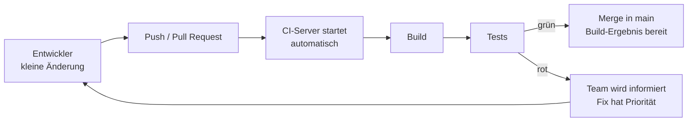
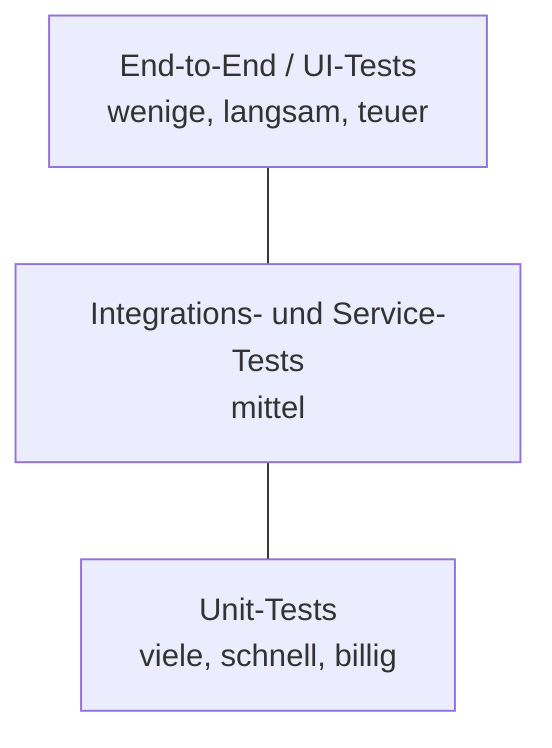
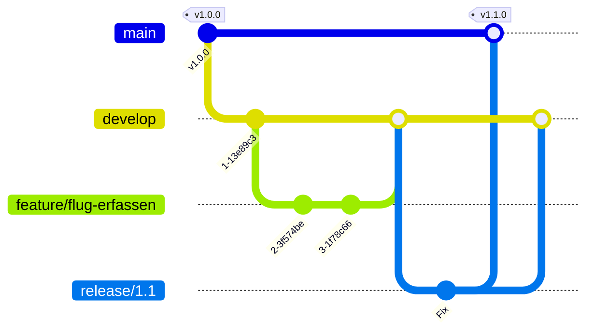
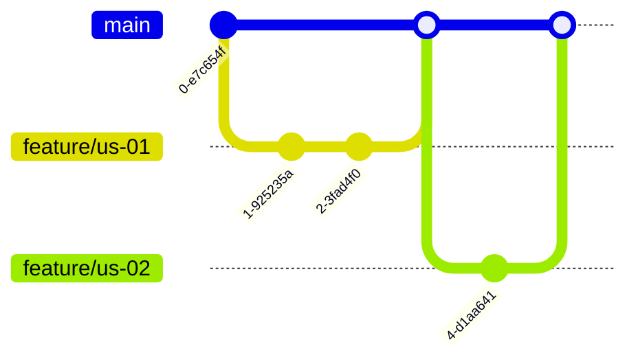
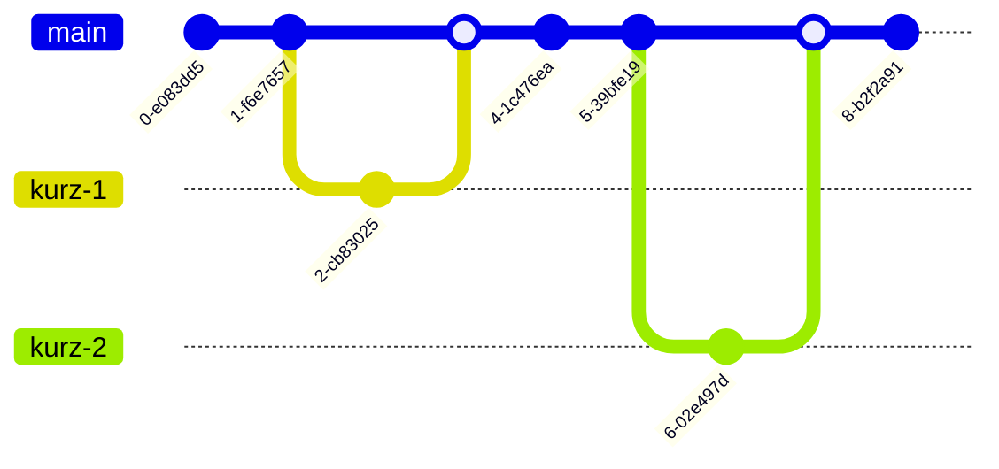
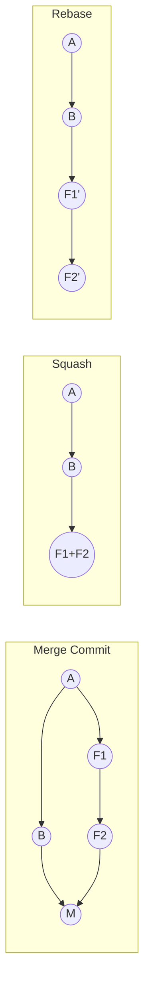
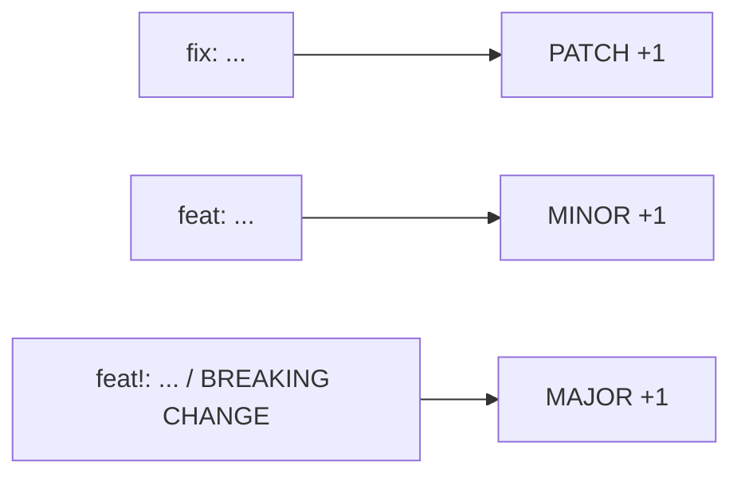
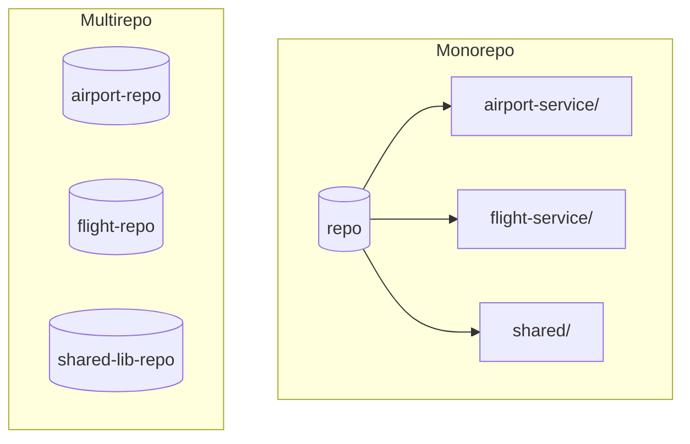
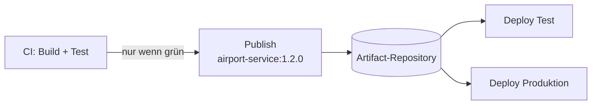
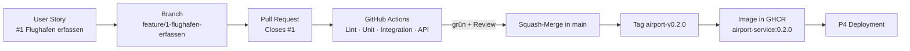

# T3 – Continuous Integration und Versionsstrategien

**Name:** Silvan Hahn  
**Modul:** M324 – DevOps  
**Auftrag:** [T3 Theorie Continuous Integration](https://gitlab.com/ch-tbz-it/Stud/m324/-/blob/main/Projekt/T3_Theorie_Continuous_Integration.md)  
**Issue:** [#12 – T3 Continuous Integration und Versionsstrategien recherchieren](https://github.com/SilvanHahnTBZ/M324-devops-gruppenprojekt-G1/issues/12)

---

## Inhalt

1. [Continuous Integration (CI)](#1-was-ist-continuous-integration-ci-und-wie-wird-es-umgesetzt)
2. [Vor- und Nachteile von CI](#2-vor--und-nachteile-von-ci)
3. [Continuous Testing](#3-was-ist-continuous-testing-und-wie-wird-es-umgesetzt)
4. [Branching-Strategien](#4-branching-strategien)
5. [Commits und Branches mit User Stories verknüpfen](#5-commits-und-branches-mit-user-stories-verknüpfen)
6. [Merge-Strategien](#6-merge-strategien)
7. [Semantic Versioning](#7-semantic-versioning)
8. [Mono- und Multirepo bei Microservices](#8-mono--und-multirepo-bei-microservices)
9. [Artifact-Repository](#9-artifact-repository)
10. [Transfer auf P3 und P3b](#10-transfer-auf-p3-ci-und-p3b-artefakt-repository)
11. [Quellenvergleich](#11-quellenvergleich)
12. [KI-Nachweis](#ki-nachweis)
13. [Quellen](#quellen)

---

## 1. Was ist Continuous Integration (CI) und wie wird es umgesetzt?

### Definition

Martin Fowler beschreibt CI als Praxis, bei der jedes Teammitglied seine Änderungen **mindestens täglich in eine gemeinsame Hauptlinie (mainline)** zusammenführt. Jede Integration wird durch einen **automatischen Build inklusive Tests** geprüft, damit Integrationsfehler sofort auffallen [1]. AWS definiert CI als DevOps-Praxis, bei der Entwickler regelmässig in ein zentrales Repository mergen und danach automatisch gebaut und getestet wird [2].

**In eigenen Worten:** CI heisst, dass niemand wochenlang allein an seinem Code arbeitet. Alle bringen ihre Änderungen oft und in kleinen Stücken zusammen, und eine Maschine prüft jedes Mal sofort, ob noch alles funktioniert.

**Wichtig:** CI ist zuerst eine **Arbeitsweise** und erst danach ein Tool. Ein GitHub-Actions-Workflow allein ist noch kein CI, wenn das Team nur einmal im Monat integriert. Fowler hält ausdrücklich fest: Wer zwar die Hauptlinie in seinen Branch zieht, aber nie zurückmergt, macht kein CI [1].

### Der Ablauf

### Praktiken nach Fowler [1]

| Praktik | Bedeutung |
|---------|-----------|
| Alles in der Versionsverwaltung | Code, Tests, Build-Skripte, Konfiguration liegen im Repository |
| Build automatisieren | Ein einziger Befehl baut das ganze System |
| Selbsttestender Build | Der Build enthält automatische Tests; ein fehlgeschlagener Test lässt den Build fehlschlagen |
| Täglich in die Hauptlinie pushen | Kleine Änderungen, damit Konflikte klein bleiben |
| Jeder Push startet einen Build | Der CI-Server reagiert auf jedes Ereignis |
| Kaputten Build sofort reparieren | Höchste Priorität; oft einfach den fehlerhaften Commit zurücknehmen (revert) |
| Build schnell halten | Nur schnelles Feedback wird ernst genommen |
| Alle sehen den Status | Build-Status ist für das ganze Team sichtbar |

### Werkzeuge

- **Versionsverwaltung:** Git mit GitHub oder GitLab
- **CI-Server:** GitHub Actions, GitLab CI/CD, Jenkins, CircleCI
- **Build-Werkzeuge:** z. B. `pip`/`uv` (Python), Maven/Gradle (Java), Docker für Container-Images
- **Testframeworks:** pytest, JUnit
- **Qualität:** Linter (z. B. Ruff), Code-Coverage, Security-Scans

### Rolle für Automatisierung und Zusammenarbeit

CI automatisiert die wiederkehrenden Schritte Build und Test (CALMS: *Automation*). Gleichzeitig verändert CI die Zusammenarbeit: Weil alle oft integrieren, sieht jeder früh die Änderungen der anderen. Der Build-Status ist ein gemeinsames Signal – ist er rot, kümmert sich das Team zuerst darum. Kent Beck formuliert das Ziel so: „No code sits unintegrated for more than a couple of hours.“ [1]

---

## 2. Vor- und Nachteile von CI

| Vorteile | Quelle |
|----------|--------|
| **Fehler werden früh gefunden**, solange die Änderung noch klein und frisch im Kopf ist | [1][2] |
| **Weniger „Integrationshölle“**: keine tagelangen Merge-Konflikte am Ende eines Projekts | [1] |
| **Weniger Bugs** durch den selbsttestenden Build | [1] |
| **Refactoring wird sicherer**, weil Tests sofort zeigen, ob etwas kaputt ging | [1] |
| **Schnellere Auslieferung**: Der Code ist jederzeit in einem baubaren Zustand; ein Release wird zur Geschäftsentscheidung statt zum technischen Kraftakt | [1][2] |
| **Höhere Produktivität**, weil manuelle Build- und Testschritte wegfallen | [2] |

| Herausforderungen / Nachteile | Erklärung |
|-------------------------------|-----------|
| **Aufbauaufwand** | Pipeline, Testumgebung und Tests müssen zuerst geschrieben werden |
| **Nur so gut wie die Tests** | Ein grüner Build mit schlechten Tests gibt falsche Sicherheit |
| **Langsame Pipelines** | Dauert der Build lange, warten Entwickler oder umgehen ihn [1] |
| **Instabile Tests (flaky tests)** | Tests, die zufällig fehlschlagen, zerstören das Vertrauen in den Build |
| **Disziplin nötig** | Häufig integrieren und kaputte Builds sofort reparieren ist eine Kulturfrage, kein Tool-Feature |
| **Kosten** | Rechenzeit auf CI-Servern, Wartung der Pipeline |

**Langfristige Wirkung:** CI hebt die Qualität, weil Fehler nicht liegen bleiben und sich nicht stapeln. Der Workflow wird ruhiger: Statt grosser, riskanter Merges gibt es viele kleine, langweilige. Das ist das Ziel.

---

## 3. Was ist Continuous Testing, und wie wird es umgesetzt?

### Definition

IBM beschreibt Continuous Testing als **automatisiertes Feedback in verschiedenen Phasen des Software-Lebenszyklus**, eng verzahnt mit CI/CD [3]. Tests laufen nicht mehr einmal am Ende, sondern bei jeder Änderung und in jeder Stufe der Pipeline.

### Unterschied zu traditionellem Testen

| Traditionell (z. B. Wasserfall) | Continuous Testing |
|---------------------------------|--------------------|
| Testphase gegen Projektende | Tests bei jedem Commit |
| Oft manuell durch ein separates Testteam | Automatisiert, Entwickler schreiben Tests mit |
| Feedback nach Wochen | Feedback nach Minuten |
| Tests prüfen das „fertige“ Produkt | Tests sind Teil des Entwicklungsprozesses (*shift-left*) und laufen auch in Produktion weiter (*shift-right*, z. B. Monitoring) [3] |

### Die Testpyramide

Die Testpyramide (Mike Cohn) sagt: Viele schnelle Unit-Tests unten, weniger Integrationstests in der Mitte, nur wenige End-to-End-Tests oben. Ham Vocke fasst die Regel zusammen: Je höher die Ebene, desto weniger Tests [4]. Das Gegenteil, viele langsame UI-Tests und kaum Unit-Tests, nennt er „Ice-Cream-Cone“ (Eistüte) – ein Anti-Pattern.

### Typische automatisierte Tests [3][4]

| Testart | Prüft | Beispiel Flughafenprojekt |
|---------|-------|---------------------------|
| **Unit-Test** | Eine Funktion isoliert | Validierung eines IATA-Codes (3 Buchstaben) |
| **Integrationstest** | Zusammenspiel mit DB, REST, Queue | Flughafen wird wirklich in PostgreSQL gespeichert |
| **Systemtest / API-Test** | Ganzer Dienst über seine Schnittstelle | `POST /airports` liefert 201, Duplikat liefert Fehler |
| **Contract-Test** | Vereinbarung zwischen zwei Diensten | Flugservice erwartet ein bestimmtes Antwortformat des Flughafenservice |
| **Smoke-Test** | Startet der Dienst überhaupt? | `/health` antwortet nach dem Deployment |
| **Regressionstest** | Alte Fehler kommen nicht zurück | Bugfix bekommt einen Test |
| **Performance-Test** | Antwortzeiten, Last | 100 Anfragen pro Sekunde |

### Wie wird die Effektivität sichergestellt?

- **Code-Coverage** messen – aber nicht blind darauf vertrauen: 100 % Coverage heisst nicht, dass sinnvoll geprüft wird.
- **Tests müssen fehlschlagen können:** Ein neuer Test wird einmal rot gesehen, bevor er grün wird.
- **Flaky Tests** sofort reparieren oder entfernen.
- **Schnelle Tests zuerst** in der Pipeline, damit das Feedback früh kommt (*fail fast*).
- **Bugs aus Produktion** werden zu neuen Tests.

---

## 4. Branching-Strategien

### Warum braucht man eine Strategie?

Eine Branching-Strategie legt fest, **welche Branches es gibt, wofür sie da sind, wie lange sie leben und wie sie zusammengeführt werden**. Ohne Regeln arbeitet jeder anders, Branches leben zu lang und die Merges werden gross und riskant. Die Strategie bestimmt direkt, wie gut CI funktioniert: Je länger ein Branch getrennt lebt, desto weniger „continuous“ ist die Integration [1][5].

### Die bekanntesten Ansätze

**Git Flow** (Vincent Driessen, 2010) [6]

- `main`/`master`: nur produktionsreife Stände, jeder Merge ist ein Release mit Tag
- `develop`: Integrationsbranch für das nächste Release
- `feature/*`, `release/*`, `hotfix/*`: unterstützende Branches mit festen Merge-Wegen

**GitHub Flow** [7]

Nur `main` plus kurze Feature-Branches: Branch erstellen → Änderungen committen → Pull Request → Review → Merge → Branch löschen.

**Trunk Based Development** [5]

Alle arbeiten auf einem einzigen Branch (*trunk* bzw. `main`) und vermeiden langlebige Entwicklungsbranches. Kurze Branches für Review und CI-Prüfung sind erlaubt, sollen aber nur Stunden bis wenige Tage leben. Kleine Teams können sogar direkt auf `main` committen. Unfertige Funktionen werden mit **Feature Flags** versteckt statt in einem Branch.

### Vergleich

| Kriterium | Git Flow | GitHub Flow | Trunk Based |
|-----------|----------|-------------|-------------|
| Langlebige Branches | `main` + `develop` | nur `main` | nur `main` (trunk) |
| Lebensdauer Feature-Branch | Tage bis Wochen | Stunden bis Tage | Stunden (max. 1–2 Tage) |
| Komplexität | hoch | tief | tief, aber hohe Disziplin |
| Passt zu CI | schlecht bis mittel | gut | sehr gut |
| Releases | geplante Versionen über `release/*` | jederzeit aus `main` | jederzeit aus `main`, ggf. kurze Release-Branches |
| Geeignet für | Software mit mehreren gleichzeitig gepflegten Versionen (z. B. installierbare Apps) | Web-Apps, kleine bis mittlere Teams | Teams mit guter Testabdeckung, Continuous Deployment |

**Bemerkenswert:** Driessen, der Erfinder von Git Flow, schrieb 2020 selbst eine Notiz über seinen Artikel: Web-Apps würden heute kontinuierlich ausgeliefert, deshalb empfiehlt er dafür einen einfacheren Ablauf wie GitHub Flow. Git Flow passe weiterhin für explizit versionierte Software [6].

### Auswirkung auf Teams

Git Flow schafft viel Ordnung, aber auch viele Übergaben und lange getrennte Arbeit – Konflikte werden spät sichtbar. Trunk Based und GitHub Flow zwingen zu kleinen Änderungen: Das Team sieht früher, woran die anderen arbeiten, braucht dafür aber gute automatische Tests und schnelle Reviews.

---

## 5. Commits und Branches mit User Stories verknüpfen

### Warum?

- **Nachvollziehbarkeit:** Zu jeder Codezeile lässt sich herausfinden, *warum* sie geändert wurde.
- **Transparenz im Board:** Der Status einer Story ist am Code ablesbar (Branch offen, PR in Review, gemergt).
- **Automatisierung:** Issues schliessen sich beim Merge, Changelogs entstehen automatisch.
- **Audits und Fehlersuche:** Bei einem Bug sieht man, mit welcher Story er kam.

### Praktiken und Konventionen

| Ebene | Konvention | Beispiel |
|-------|-----------|----------|
| **Branch-Name** | `<typ>/<issue>-<kurzbeschreibung>` | `feature/1-flughafen-erfassen` |
| **Commit-Message** | Conventional Commits: `<typ>(<bereich>): <beschreibung>` [8] | `feat(airport): Flughafen per POST erfassen (#1)` |
| **Pull Request** | Schlüsselwort + Issue-Nummer in der Beschreibung [9] | `Closes #1` |
| **Release** | Tag + automatisch erzeugte Release Notes | `v0.1.0` mit Liste aller gemergten PRs |

**Conventional Commits** [8] gibt Commit-Typen eine Bedeutung: `fix` = Fehlerbehebung, `feat` = neue Funktion, `BREAKING CHANGE` bzw. `!` = inkompatible Änderung; dazu `docs`, `test`, `ci`, `refactor` usw. Diese Typen lassen sich direkt auf Semantic Versioning abbilden (siehe Kapitel 7).

### Tool-Unterstützung

- **GitHub:** Schlüsselwörter wie `close(s)`, `fix(es)`, `resolve(s)` gefolgt von `#Nummer` verknüpfen einen PR mit einem Issue und schliessen es beim Merge. Das funktioniert nur, wenn der PR in den **Default-Branch** gemergt wird [9]. In der Issue-Seitenleiste kann man über „Create a branch“ direkt einen Branch zur Story anlegen.
- **GitHub Projects:** Workflows verschieben die Karte automatisch, z. B. auf *Done*, wenn das Issue geschlossen wird. Das haben wir bei T2 erlebt: Nach dem Merge von PR #25 ist #11 von selbst auf *Done* gesprungen.
- **Jira/GitLab:** Issue-Schlüssel wie `FLUG-12` im Branch- oder Commit-Namen werden automatisch erkannt und verlinkt.

---

## 6. Merge-Strategien

| Strategie | Was passiert | Historie | Wann verwenden |
|-----------|--------------|----------|----------------|
| **Merge Commit** (`--no-ff`) | Alle Commits des Branches bleiben erhalten, dazu ein zusätzlicher Merge-Commit [10] | Vollständig, zeigt, wann welcher Branch gemergt wurde; wird aber verzweigt und unübersichtlich | Wenn die genaue Entwicklungsgeschichte wichtig ist; Standard bei GitHub und Git Flow [6][10] |
| **Squash and Merge** | Alle Commits werden zu **einem** Commit zusammengefasst [10] | Linear und sauber: ein Commit pro Feature/PR; Zwischenschritte und ursprüngliche Zeitstempel gehen verloren | Viele kleine „WIP“-Commits; ein PR = eine Story = ein Commit |
| **Rebase and Merge** | Die Commits werden einzeln auf den Ziel-Branch „umgehängt“ und bekommen neue IDs [10] | Linear, alle Einzelcommits bleiben; Commits werden aber umgeschrieben | Saubere, gut geschnittene Einzelcommits, Team will lineare Historie |
| **Fast-Forward** | Wenn `main` sich nicht verändert hat, wird der Zeiger einfach nachgezogen | Linear, kein Merge-Commit | Kleine Änderungen auf aktuellem Stand |

**Achtung bei Rebase:** Weil Commits neu geschrieben werden, darf man Branches, an denen andere mitarbeiten, nicht einfach rebasen und force-pushen. GitHub weist zudem darauf hin, dass beim Rebase-Merge Commit-Signaturen nicht erhalten bleiben [10].

**Eigene Einschätzung:** Für unser Projekt mit kurzen Feature-Branches passt **Squash and Merge** am besten: Jede User Story wird zu genau einem Commit auf `main` mit der Issue-Nummer. Die Historie bleibt lesbar und lässt sich direkt für Release Notes nutzen.

---

## 7. Semantic Versioning

### Das Format `MAJOR.MINOR.PATCH` [11]

| Teil | Wird erhöht, wenn … | Beispiel |
|------|---------------------|----------|
| **MAJOR** | inkompatible Änderung der öffentlichen API | `1.4.2` → `2.0.0`: Feld `code` heisst neu `iataCode` |
| **MINOR** | neue Funktion, rückwärtskompatibel | `1.4.2` → `1.5.0`: neuer Endpoint `GET /airports/{code}` |
| **PATCH** | rückwärtskompatibler Bugfix | `1.4.2` → `1.4.3`: Kleinbuchstaben im Code werden korrekt abgelehnt |

Weitere Regeln nach semver.org [11]:

- Wird eine Stelle erhöht, werden die rechten Stellen auf 0 gesetzt (`1.4.2` → `1.5.0`).
- **`0.y.z`** ist für die erste Entwicklung: Alles darf sich ändern, die API gilt als nicht stabil. Empfohlener Start: `0.1.0`.
- **`1.0.0`** definiert die öffentliche API.
- **Pre-Release** mit Bindestrich: `1.0.0-alpha`, `1.0.0-rc.1` – hat tiefere Priorität als `1.0.0`.
- **Build-Metadaten** mit Plus: `1.0.0+20261116.sha.a1b2c3` – beeinflusst die Reihenfolge nicht.
- Eine veröffentlichte Version darf **nie verändert** werden; jede Änderung braucht eine neue Version.

### Warum ist das wichtig?

Die Versionsnummer ist eine **Botschaft an die Nutzer**: Wer `2.x` sieht, weiss, dass er seinen Code anpassen muss. Wer von `1.4.2` auf `1.4.3` geht, kann gefahrlos updaten. Bei Microservices ist das zentral: Unser **Flugservice ruft die API des Flughafenservice auf**. Eine MAJOR-Version beim Flughafenservice signalisiert, dass der Flugservice betroffen ist.

### Zusammenspiel mit Commits und Branches

Mit Conventional Commits [8] lässt sich die nächste Version automatisch aus den Commit-Typen berechnen (z. B. mit *semantic-release*). Der Git-Tag `v1.5.0` auf `main` markiert das Release, und die CI baut daraus das versionierte Artefakt.

---

## 8. Mono- und Multirepo bei Microservices

### Begriffe

- **Monorepo:** *ein* Repository mit mehreren eigenständigen Projekten und klar definierten Beziehungen. Ein Monorepo ist **kein Monolith** – die Dienste bleiben getrennt deploybar [12].
- **Multirepo (Polyrepo):** jeder Dienst bzw. jede Bibliothek hat ein eigenes Repository [13].

### Vor- und Nachteile

| | Monorepo | Multirepo |
|---|---|---|
| **Code teilen** | Einfach, gemeinsame Bibliotheken direkt nutzbar [12][13] | Bibliotheken müssen publiziert und versioniert werden [14] |
| **Änderungen über Dienste hinweg** | Ein atomarer Commit / PR für beide Dienste [12][13] | Mehrere PRs in mehreren Repos koordinieren |
| **Versionierung** | Eine Version für alles wird schwierig; pro Dienst eigene Tags nötig [13] | Jeder Dienst hat natürlich seine eigene Version und eigenen Release-Zyklus [14] |
| **Zugriffsrechte** | Standardmässig sieht jeder alles [13] | Pro Repo steuerbar [14] |
| **CI** | Ohne Pfadfilter baut und testet jeder Push alles – langsam bei grossen Repos [13][14] | Pipeline pro Dienst, klein und schnell |
| **Team-Autonomie** | Gemeinsame Regeln, Tools und Konventionen einfach durchsetzbar [12] | Teams entscheiden unabhängig, Gefahr von Wildwuchs [14] |
| **Skalierung** | Git und Build-Tools stossen bei sehr grossen Repos an Grenzen [13] | Skaliert gut, aber Übersicht über das Gesamtsystem fehlt |

Kinsta fasst zusammen, dass es keine vorgegebene richtige Antwort gibt; die Wahl hängt u. a. von Codebasis-Grösse und Anzahl Teams ab [14].

**Eigene Einschätzung:** Für unser Team (4 Personen, 2 Dienste, ein Semester) ist ein **Monorepo** sinnvoll: Alles ist an einem Ort, die Lehrperson braucht nur einen Zugang, und Änderungen an der Schnittstelle zwischen Flug- und Flughafenservice lassen sich in einem PR prüfen. Damit die CI nicht immer alles baut, setzen wir in GitHub Actions **Pfadfilter** (`paths: Code/airport-service/**`) und taggen die Dienste getrennt.

---

## 9. Artifact-Repository

### Definition und Rolle

Ein **Artefakt** ist das Ergebnis eines Builds: ein Container-Image, ein Python-Paket, eine JAR-Datei usw. Ein **Artifact-Repository** (auch Registry) ist der zentrale Ort, an dem diese Ergebnisse **versioniert abgelegt, verwaltet und bereitgestellt** werden. JFrog beschreibt es als Ort, um Artefakte in einer geordneten Gruppe zu organisieren [15]; Sonatype als einen vertrauenswürdigen Ort, um Pakete, Container und Build-Artefakte zu beziehen, zu publizieren und zu verwalten [16].

**Abgrenzung:** Das **Git-Repository** speichert den *Quellcode*. Das **Artifact-Repository** speichert das *gebaute Ergebnis*.

### Arten von Artefakten

| Typ | Beispiel | Registry |
|-----|----------|----------|
| Container-Images | `airport-service:1.2.0` | GitHub Container Registry, Docker Hub, Harbor |
| Sprachpakete | Python-Wheel, npm-Paket, Maven-JAR, NuGet | PyPI, npm, Maven Central, GitHub Packages [17] |
| Helm-Charts | Kubernetes-Deployment-Paket | Artifactory, Nexus |
| Binärdateien | `.exe`, `.zip`, Firmware | Artifactory, GitHub Releases |

### Repository-Typen bei JFrog [15]

- **Local:** eigene Build-Ergebnisse
- **Remote:** Cache bzw. Proxy für externe Quellen (z. B. PyPI) – schneller und unabhängig von Ausfällen
- **Virtual:** fasst mehrere Local- und Remote-Repos unter einer Adresse zusammen

### Warum wichtig für CI/CD?

- **„Build once, deploy many“:** Dasselbe geprüfte Artefakt geht in Test und Produktion. Es wird nicht für jede Umgebung neu gebaut, deshalb ist das, was getestet wurde, genau das, was live geht.
- **Reproduzierbarkeit und Rollback:** Jede Version bleibt gespeichert; bei einem Fehler deployt man einfach wieder `1.1.0`.
- **Nachvollziehbarkeit:** Version und Tag zeigen, aus welchem Commit ein Artefakt stammt.
- **Sicherheit:** Zugriffsrechte, Scans auf Schwachstellen, Schutz vor manipulierten Paketen [16].
- **Trennung von CI und CD:** Die CI liefert ein Artefakt ab, die CD holt es dort ab. Genau diese Schnittstelle bauen wir in P3b und P4.

---

## 10. Transfer auf P3 (CI) und P3b (Artefakt-Repository)

> Vorschlag für das Team, abgeleitet aus T3. Die verbindlichen Regeln legen wir in D2 (#6), P3 (#15) und P3b (#16) gemeinsam fest.

### Zusammenhang im Projekt

| Thema | Vorschlag für unser Projekt | Begründung |
|-------|----------------------------|------------|
| **Branching (D2)** | GitHub Flow / Trunk Based: `main` + kurze Branches `feature/<issue>-<name>`, `fix/<issue>-<name>`, `docs/…` | Kleines Team, Web-API, passt zu CI [5][6][7] |
| **Verknüpfung** | Issue-Nummer im Branch, Conventional Commits, `Closes #<n>` im PR | Board wird automatisch aktualisiert [8][9] |
| **Merge** | Squash and Merge, `main` geschützt (PR + grüner CI-Lauf nötig) | Ein Commit pro Story, saubere Historie [10] |
| **CI-Trigger (P3)** | `pull_request` auf `main` und `push` auf `main`, mit Pfadfiltern pro Dienst | Jede Änderung wird vor dem Merge geprüft [1] |
| **Teststufen (P3)** | 1. Ruff (Lint) → 2. pytest Unit → 3. Integration mit PostgreSQL-Service-Container → 4. API-Test Flugservice ↔ Flughafenservice | Testpyramide, schnelle Tests zuerst [3][4] |
| **CI-Varianten (P3)** | Variante A: ein Job für alles; Variante B: getrennte Jobs pro Dienst und Teststufe, parallel mit Pip-Cache | P3 verlangt den Vergleich von zwei Varianten nach Laufzeit, Stabilität und Nachvollziehbarkeit |
| **Versionierung** | SemVer pro Dienst, Start bei `0.1.0`, Tags `airport-v0.1.0` und `flight-v0.1.0`; `1.0.0` erst bei stabiler API | 0.y.z = API noch nicht stabil [11] |
| **Repo** | Monorepo (bestehendes Repo, Ordner `Code/airport-service` und `Code/flight-service`) | Kapitel 8 |
| **Artefakt (P3b)** | Docker-Images in der **GitHub Container Registry (ghcr.io)**, Tags `0.2.0`, `0.2` und `sha-<commit>` | Gleiche Plattform wie Repo und Actions; Container passen zu P4 [17] |
| **Publish-Regel (P3b)** | Publish-Job mit `needs: [test]`, läuft nur nach grünem Build und Test und nur bei einem Versions-Tag | „Build once, deploy many“ |
| **Secrets (P3b)** | Publizieren mit dem automatischen `GITHUB_TOKEN` und `permissions: packages: write`; keine Tokens im Code oder in KI-Tools | Minimalrechte [17] |

### Was passiert bei einem fehlgeschlagenen Test? (Vorbereitung Fachgespräch)

1. Ein Entwickler pusht in seinen Branch, der PR startet die CI.
2. Ein Unit-Test schlägt fehl → der Job wird **rot**, spätere Jobs (Integration, Publish) laufen nicht.
3. Der PR kann wegen der Branch-Protection **nicht gemergt** werden; `main` bleibt grün.
4. **Kein Artefakt** wird publiziert, also kann P4 auch nichts Fehlerhaftes deployen.
5. Der Entwickler sieht im Log, welcher Test fehlschlug, behebt den Fehler und pusht erneut → die CI läuft neu.

Wäre der Fehler trotzdem auf `main` gelandet (z. B. ein Test fehlt), gilt Fowlers Regel: Build sofort reparieren oder den Commit zurücknehmen [1].

---

## 11. Quellenvergleich

| Thema | Unterschied zwischen den Quellen | Meine Schlussfolgerung |
|-------|----------------------------------|------------------------|
| Umfang von CI | AWS beschränkt CI auf Build und Unit-Tests [2]. IBM zählt viele weitere Testarten zum Continuous Testing [3]; der P3-Auftrag verlangt auch Integrations- und Systemtests. | CI umfasst Build und alle automatisierbaren Tests, die schnell genug sind. Langsame Tests können in eine spätere Pipeline-Stufe. |
| Branches und CI | Fowler: Wer nicht in die Hauptlinie zurückmergt, macht kein CI [1]. Trunk Based Development erlaubt kurze Branches für Review und CI-Prüfung [5]. | Kein Widerspruch: Entscheidend ist, dass Branches **kurz** leben und schnell in `main` landen. |
| Git Flow | Driessen hat Git Flow erfunden [6], empfiehlt aber 2020 selbst für Web-Apps einfachere Abläufe. trunkbaseddevelopment.com rät generell davon ab [5]. | Git Flow ist nicht veraltet, sondern für versionierte Software mit mehreren gepflegten Versionen gedacht. Für unsere API passt GitHub Flow besser. |
| Monorepo | monorepo.tools listet nur Vorteile [12] – die Seite stammt vom Anbieter eines Monorepo-Tools (Nx). Wikipedia [13] und Kinsta [14] nennen auch Nachteile (CI-Laufzeit, Zugriffsrechte, Versionierung). | Herstellerquellen sind einseitig. Ich habe deshalb neutrale Quellen dazugenommen. |
| Artifact-Repository | JFrog [15] und Sonatype [16] sind Hersteller solcher Produkte; die Definition ist ähnlich, die Vorteile werden betont. | Für die Begriffe brauchbar; für unsere Wahl (GHCR) zählt die offizielle GitHub-Dokumentation [17]. |

---

## KI-Nachweis

| | |
|---|---|
| **Eingesetztes Tool** | Claude (Anthropic) in Claude Code |
| **Wofür** | Quellensuche und Abgleich, Entwurf der Kapitel 1–11, Diagramme (Mermaid), Vorschlag für den Transfer auf P3/P3b |
| **Prompt (Auszug)** | „Machen wir das gleiche jetzt mit T3 durch, aber effizienter.“ (Auftrag T3 eingefügt) |
| **KI-Hinweis (ausgewählt)** | Ein erster Entwurf setzte CI mit „eine Pipeline in GitHub Actions einrichten“ gleich. |
| **Geprüft mit** | Fowler [1]: CI ist vor allem die Praxis, mindestens täglich in die Hauptlinie zu integrieren; ein Branch, der nicht zurückgemergt wird, ist kein CI. |
| **Korrektur** | Kapitel 1 betont jetzt, dass CI eine Arbeitsweise ist und das Tool nur das Mittel. |
| **Zweiter geprüfter Punkt** | Die Aussage „Git Flow ist der Standard“ wurde mit dem Originalartikel [6] verglichen: Der Autor empfiehlt seit 2020 für Web-Apps selbst einfachere Modelle. Kapitel 4 und der Quellenvergleich wurden angepasst. |
| **Eigener Anteil** | Zusammenfassung der Kapitel 1–10 gelesen und die Verständnisfragen der KI ohne Unterlagen selbst beantwortet (siehe unten). |
| **Verständnisprüfung** | Die KI hat mir 5 Fragen und einen Kontrollfall ohne Unterlagen gestellt. **Richtig:** Artifact-Repository = „Build once, deploy many“, einfacher Rollback; SemVer-Bugfix `1.4.2` → `1.4.3`. **Teilweise richtig:** CI ist nur so gut wie die Tests, mir fehlte aber der Kern (oft und klein in `main` integrieren). Bei einem fehlgeschlagenen Test wusste ich, dass die Pipeline fehlschlägt und man fixt; mir fehlten die Folgen (kein Merge, keine weiteren Jobs, kein Artefakt). **Korrigiert:** Ich hatte Git Flow als passender für CI und Trunk Based als „grosse Änderungen“ bezeichnet – es ist umgekehrt [5][6]. Bei SemVer hatte ich die rechten Stellen nicht auf 0 gesetzt (`1.5.2` statt `1.5.0`, `2.4.2` statt `2.0.0`) [11]. **Veränderter Fall danach selbst gelöst:** `0.3.7` → neues Feature `0.4.0` → Bugfix `0.4.1` (richtig). Branching-Strategien und die Folgen eines roten Tests wiederhole ich vor dem Fachgespräch. |
| **Eigene Schlussfolgerung** | Am meisten mitgenommen habe ich, dass Trunk Based Development besser zu CI passt als Git Flow, weil kurze Branches und kleine Änderungen oft integriert werden. |

---

## Quellen

Alle Quellen abgerufen am 16.11.2026.

1. Martin Fowler: *Continuous Integration* (2024). <https://martinfowler.com/articles/continuousIntegration.html>
2. AWS: *What is Continuous Integration?* <https://aws.amazon.com/devops/continuous-integration/>
3. IBM: *What Is Continuous Testing?* <https://www.ibm.com/think/topics/continuous-testing>
4. Ham Vocke: *The Practical Test Pyramid* (martinfowler.com, 2018). <https://martinfowler.com/articles/practical-test-pyramid.html>
5. Paul Hammant: *Trunk Based Development*. <https://trunkbaseddevelopment.com/>
6. Vincent Driessen: *A successful Git branching model* (2010, Notiz 2020). <https://nvie.com/posts/a-successful-git-branching-model/>
7. GitHub Docs: *GitHub flow*. <https://docs.github.com/en/get-started/using-github/github-flow>
8. *Konventionelle Commits 1.0.0*. <https://www.conventionalcommits.org/de/v1.0.0/>
9. GitHub Docs: *Linking a pull request to an issue*. <https://docs.github.com/en/issues/tracking-your-work-with-issues/using-issues/linking-a-pull-request-to-an-issue>
10. GitHub Docs: *About merge methods on GitHub*. <https://docs.github.com/en/repositories/configuring-branches-and-merges-in-your-repository/configuring-pull-request-merges/about-merge-methods-on-github>
11. *Semantic Versioning 2.0.0*. <https://semver.org/lang/de/>
12. Nx: *Monorepo Explained*. <https://monorepo.tools/>
13. Wikipedia: *Monorepo*. <https://en.wikipedia.org/wiki/Monorepo>
14. Kinsta: *Monorepo vs Multi-Repo: Pros and Cons*. <https://kinsta.com/blog/monorepo-vs-multi-repo/>
15. JFrog: *Repository Management* (Artifactory-Dokumentation). <https://docs.jfrog.com/artifactory/docs/repository-management>
16. Sonatype: *Nexus Repository*. <https://www.sonatype.com/products/sonatype-nexus-repository>
17. GitHub Docs: *Introduction to GitHub Packages*. <https://docs.github.com/en/packages/learn-github-packages/introduction-to-github-packages>
18. TBZ M324: Aufträge [P3](https://gitlab.com/ch-tbz-it/Stud/m324/-/blob/main/Projekt/P3_Praxis_CI.md), [P3b](https://gitlab.com/ch-tbz-it/Stud/m324/-/blob/main/Projekt/P3b_Praxis_ArtifactRepository.md), [D2](https://gitlab.com/ch-tbz-it/Stud/m324/-/blob/main/Projekt/D2_Branching_Strategie.md)
