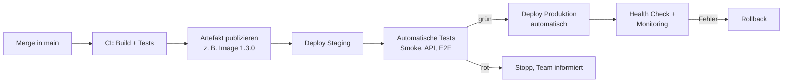
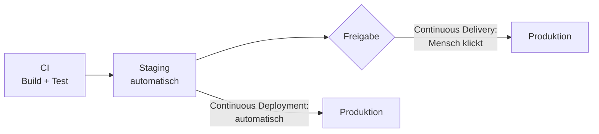
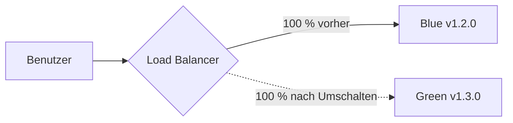
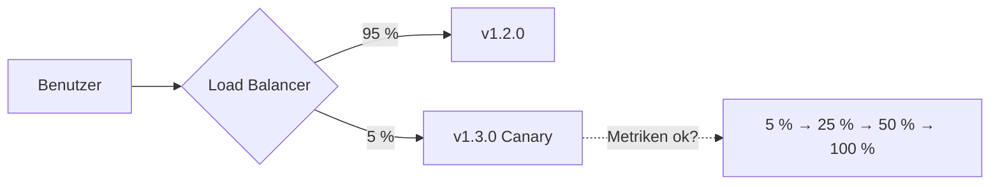
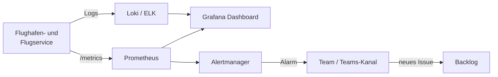
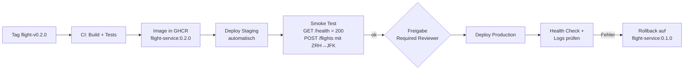

# T4 – Continuous Delivery, Continuous Deployment und Betriebsrisiken

**Name:** Silvan Hahn  
**Modul:** M324 – DevOps  
**Auftrag:** [T4 Theorie Continuous Deployment](https://gitlab.com/ch-tbz-it/Stud/m324/-/blob/main/Projekt/T4_Theorie_Continuous_Deployment.md)  
**Issue:** [#13 – T4 Continuous Delivery, Deployment und Betriebsrisiken vergleichen](https://github.com/SilvanHahnTBZ/M324-devops-gruppenprojekt-G1/issues/13)

---

## Inhalt

1. [Continuous Deployment](#1-was-ist-continuous-deployment-und-wie-wird-es-umgesetzt)
2. [Delivery vs. Deployment](#2-unterschied-continuous-delivery-und-continuous-deployment)
3. [Vor- und Nachteile](#3-vor--und-nachteile)
4. [Blue/Green und Canary](#4-deployment-strategien-bluegreen-und-canary)
5. [A/B Testing](#5-ab-testing)
6. [Feature Toggles](#6-feature-toggles)
7. [Rollback-Strategien](#7-rollback-strategien)
8. [Continuous Monitoring](#8-continuous-monitoring)
9. [Passwörter und Secrets sicher speichern](#9-passwörter-und-secrets-sicher-speichern)
10. [Arten von Deployment](#10-arten-von-deployment)
11. [Transfer auf P4](#11-transfer-auf-p4-deployment-rollback-und-monitoring)
12. [Quellenvergleich](#12-quellenvergleich)
13. [KI-Nachweis](#ki-nachweis)
14. [Quellen](#quellen)

---

## 1. Was ist Continuous Deployment und wie wird es umgesetzt?

### Definition

Bei **Continuous Deployment** geht **jede Änderung, die alle automatischen Prüfungen besteht, automatisch in die Produktion** – ohne manuellen Schritt [1][2]. Es ist die konsequente Fortsetzung von CI (T3): CI sorgt dafür, dass der Code gebaut und getestet ist; Continuous Deployment bringt ihn danach selbstständig zu den Benutzern.

**In eigenen Worten:** Ein Entwickler mergt seinen Pull Request – und ein paar Minuten später ist die Änderung live, ohne dass jemand auf einen „Deploy“-Knopf drückt. Die Pipeline entscheidet anhand der Tests, ob es weitergeht.

### Ablauf



### Voraussetzungen für die Umsetzung

- **Sehr gute automatische Tests** – sie sind die einzige Kontrolle vor der Produktion.
- **Versionierte Artefakte** aus einem Artifact-Repository („build once, deploy many“, T3).
- **Automatisierte Infrastruktur** (Container, Infrastructure as Code), damit jedes Deployment gleich abläuft.
- **Risikoarme Deployment-Strategien** wie Rolling, Blue/Green oder Canary (Kapitel 4).
- **Monitoring und schneller Rollback**, weil Fehler trotz Tests in Produktion gelangen können (Kapitel 7 und 8).
- **Feature Toggles**, um unfertige Funktionen zu verstecken, obwohl der Code schon live ist (Kapitel 6).

---

## 2. Unterschied Continuous Delivery und Continuous Deployment

Beide werden mit **CD** abgekürzt, was oft zu Verwirrung führt.

| | Continuous Delivery | Continuous Deployment |
|---|---|---|
| **Kernaussage** | Die Software ist **jederzeit auslieferbar** [1] | Jede geprüfte Änderung **wird automatisch ausgeliefert** [1] |
| **Schritt in Produktion** | **Manuelle Freigabe** (Knopfdruck, Approval) [2] | **Vollautomatisch**, keine Freigabe [2] |
| **Wer entscheidet** | Mensch, oft aus geschäftlichen Gründen | Die Pipeline (Tests) |
| **Release-Takt** | Wann das Business will | So oft gemergt wird, oft mehrmals täglich |



Martin Fowler bringt es auf den Punkt: „In order to do Continuous Deployment you must be doing Continuous Delivery.“ [1] – Continuous Delivery ist also die Voraussetzung, Continuous Deployment der letzte Automatisierungsschritt. Bei Continuous Delivery *könnte* man jederzeit deployen, entscheidet sich aber manchmal bewusst dagegen [1].

**Beispiel GitHub:** Eine *Environment* „production“ mit **Required Reviewers** ist Continuous Delivery – der Deploy-Job wartet, bis eine berechtigte Person zustimmt [3]. Ohne diese Regel ist es Continuous Deployment.

---

## 3. Vor- und Nachteile

| | Continuous Delivery | Continuous Deployment |
|---|---|---|
| **Vorteile** | Mensch behält Kontrolle über den Zeitpunkt (z. B. nicht vor dem Wochenende, abgestimmt mit Marketing); erfüllt Freigabe- und Compliance-Vorgaben (z. B. Banken); Release ist trotzdem nur ein Knopfdruck [1][2] | Schnellstes Feedback von echten Benutzern; sehr kleine Änderungen pro Release → geringes Risiko und einfache Fehlersuche; kein Warten auf Freigaben (*First Way*, T1) |
| **Nachteile** | Wartende Änderungen sammeln sich an → grössere Releases; Freigabe kann zum Flaschenhals werden | Fehler gelangen ohne menschliche Kontrolle live, wenn Tests Lücken haben; braucht hohe Testabdeckung, Monitoring und Feature Toggles; für regulierte Bereiche oft nicht erlaubt |
| **Passt zu** | Regulierte Branchen, Produkte mit Release-Terminen, Teams mit noch lückenhaften Tests | SaaS und Web-Apps mit starker Testkultur |

**Eigene Einschätzung:** Für unser Schulprojekt ist **Continuous Delivery mit manueller Freigabe für die Produktion** realistischer. Unsere Tests sind neu und nicht vollständig, und die Lehrperson soll ein Deployment gezielt auslösen und nachvollziehen können. Staging wird dagegen vollautomatisch deployt (siehe Kapitel 11).

---

## 4. Deployment-Strategien: Blue/Green und Canary

### Blue/Green Deployment

Es gibt **zwei möglichst identische Produktionsumgebungen**. Eine („Blue“) ist live, die andere („Green“) bekommt die neue Version und wird getestet. Danach schaltet der Router bzw. Load Balancer den gesamten Verkehr auf Green um. **Rollback** heisst: den Router einfach zurück auf Blue stellen [4][5].



**Umsetzung:** zweite Umgebung bereitstellen → neue Version auf Green deployen → Smoke Tests auf Green → Load Balancer / DNS / Kubernetes-Service umschalten → Blue als Reserve behalten.

| Vorteile | Nachteile |
|----------|-----------|
| Umschalten und Rollback in Sekunden [4] | Doppelte Infrastruktur, doppelte Kosten |
| Kein Downtime | **Datenbank** ist gemeinsam: Schemaänderungen müssen rückwärtskompatibel und in getrennten Schritten erfolgen [4] |
| Neue Version vor dem Umschalten in echter Umgebung testbar | Alle Benutzer bekommen die neue Version gleichzeitig – ein Fehler trifft alle |

### Canary Deployment (Canary Release)

Der Name kommt vom Kanarienvogel, den Bergleute als Frühwarnsystem mitnahmen. Die neue Version wird zuerst nur auf einen **kleinen Teil der Infrastruktur** ausgerollt und bekommt nur **einen kleinen Teil der Benutzer** (z. B. 5 %). Läuft alles gut, wird der Anteil schrittweise erhöht. Bei Problemen werden die Benutzer zurück auf die alte Version geleitet [6].



| Vorteile | Nachteile |
|----------|-----------|
| Fehler treffen nur wenige Benutzer (kleiner „Blast Radius“) | Zwei Versionen laufen gleichzeitig → API und DB müssen mit beiden funktionieren [6] |
| Test unter echter Last und mit echten Daten [6] | Gutes Monitoring nötig, um Probleme im kleinen Anteil zu erkennen |
| Keine doppelte Infrastruktur nötig | Aufwendiger Traffic-Split (Load Balancer, Service Mesh) |

### Weitere Strategien im Vergleich

| Strategie | Ablauf | Downtime | Rollback | Kosten |
|-----------|--------|----------|----------|--------|
| **Recreate / Big Bang** | Alte Version stoppen, neue starten [7] | Ja | Alte Version neu deployen | Tief |
| **Rolling Update** | Instanzen nacheinander ersetzen; Kubernetes-Standard, standardmässig max. 25 % gleichzeitig nicht verfügbar [7] | Nein | `kubectl rollout undo` [7] | Tief |
| **Blue/Green** | Zwei Umgebungen, Umschalten [4] | Nein | Sofort (Router zurück) | Hoch |
| **Canary** | Schrittweiser Anteil der Benutzer [6] | Nein | Schnell (Traffic zurück) | Mittel |

---

## 5. A/B Testing

A/B Testing (auch Split Testing) zeigt **zwei Varianten** einer Seite oder Funktion **zufällig verteilt** an verschiedene Benutzergruppen und misst mit statistischen Methoden, welche besser abschneidet, z. B. mehr Klicks oder Käufe [8].

| | Canary Release | A/B Testing |
|---|---|---|
| **Frage** | Ist die neue Version **technisch stabil**? | Welche Variante ist **für das Business besser**? |
| **Zielgruppe** | Kleiner, wachsender Anteil | Meist fixe Aufteilung (z. B. 50/50), stabile Gruppen |
| **Dauer** | Minuten bis Stunden, dann 100 % | Tage bis Wochen, bis das Ergebnis statistisch sicher ist |
| **Messgrösse** | Fehlerrate, Latenz | Conversion, Klickrate |

Fowler warnt ausdrücklich davor, Canary Releases und A/B Tests zu vermischen [6]. Technisch werden A/B Tests oft mit **Experiment-Toggles** umgesetzt (Kapitel 6) [9]. Das verbindet A/B Testing mit dem MVP-Gedanken aus T2: Man baut zwei Varianten und lässt echte Benutzer entscheiden (Build → Measure → Learn).

---

## 6. Feature Toggles

Ein **Feature Toggle** (Feature Flag) ist ein Schalter im Code, mit dem eine Funktion **zur Laufzeit ein- oder ausgeschaltet** werden kann – ohne neues Deployment [9].

```python
if flags.is_enabled("neue_flugsuche", user):
    return neue_suche(query)
return alte_suche(query)
```

Damit wird **Deployment (Code ist live) von Release (Funktion ist sichtbar) getrennt**. Das ist die Grundlage für Trunk Based Development (T3): Unfertiger Code darf auf `main`, solange der Schalter aus ist.

### Arten nach Pete Hodgson [9]

| Typ | Zweck | Lebensdauer |
|-----|-------|-------------|
| **Release Toggle** | Unfertige Funktionen verstecken | Kurz, ca. 1–2 Wochen |
| **Experiment Toggle** | A/B Tests mit stabilen Benutzergruppen | Bis das Experiment entschieden ist |
| **Ops Toggle** | Notschalter (*Kill Switch*), z. B. teure Funktion bei Last abschalten | Meist kurz, teils dauerhaft |
| **Permission Toggle** | Funktion nur für bestimmte Benutzer (Premium, Beta-Tester, Admins) | Lang, teils Jahre |

**Risiko „Toggle-Schulden“:** Jeder Schalter verdoppelt mögliche Code-Pfade, die getestet werden müssen. Alte Schalter müssen deshalb geplant entfernt werden [9].

---

## 7. Rollback-Strategien

Ein **Rollback** stellt nach einem fehlerhaften Release den letzten funktionierenden Zustand wieder her.

| Strategie | Wie | Geschwindigkeit | Voraussetzung |
|-----------|-----|-----------------|---------------|
| **Redeploy der Vorversion** | Pipeline mit dem alten Artefakt-Tag erneut ausführen (`airport-service:1.2.0`) | Minuten | Versionierte Artefakte (T3, P3b) |
| **Plattform-Rollback** | `kubectl rollout undo deployment/...` oder `docker service rollback` [7][10] | Sekunden bis Minuten | Kubernetes speichert standardmässig 10 Revisionen [7] |
| **Blue/Green-Switch** | Router zurück auf die alte Umgebung [4] | Sekunden | Alte Umgebung läuft noch |
| **Canary abbrechen** | Traffic-Anteil der neuen Version auf 0 % [6] | Sekunden | Traffic-Steuerung |
| **Feature Toggle aus** | Nur die fehlerhafte Funktion abschalten [9] | Sekunden | Funktion steckt hinter einem Toggle |
| **Roll Forward** | Fehler schnell beheben und neue Version deployen | Minuten bis Stunden | Schnelle Pipeline, kleiner Fehler |
| **Git Revert** | Commit zurücknehmen, Pipeline baut neu | Minuten | CI/CD läuft automatisch |

### Die Datenbank als grösstes Problem

Code lässt sich leicht zurücksetzen, **Daten nicht**. Hat die neue Version das Datenbankschema verändert (z. B. Spalte umbenannt), funktioniert die alte Version danach evtl. nicht mehr. Lösung: **Expand-and-Contract**: Zuerst nur Neues hinzufügen (neue Spalte), beide Versionen funktionieren; erst ein späteres Release entfernt das Alte [4].

### Automatischer Rollback

Ein Deployment gilt erst als erfolgreich, wenn der **Health Check** und der **Smoke Test** bestehen. Schlägt einer fehl oder steigt die Fehlerrate im Monitoring, kann die Pipeline automatisch zurückrollen.

---

## 8. Continuous Monitoring

### Definition

**Continuous Monitoring** bedeutet, Anwendungen und Infrastruktur **dauerhaft und automatisch zu überwachen**, um Fehler, Leistungsprobleme und Sicherheitsvorfälle sofort zu erkennen – nicht erst, wenn sich Benutzer beschweren. Es schliesst die DevOps-Schleife aus T2: **Monitor → Plan**.

IBM unterscheidet dabei **Monitoring** (bekannte Probleme anhand vordefinierter Metriken erkennen) und **Observability** (auch unbekannte Probleme anhand von Telemetrie verstehen); Observability ergänzt das Monitoring, ersetzt es aber nicht [11].

### Die drei Datenarten (Telemetrie) [11]

| Daten | Beispiel |
|-------|----------|
| **Metriken** | Anfragen pro Sekunde, CPU, Fehlerrate |
| **Logs** | `ERROR Flughafen ZRH nicht gefunden` |
| **Traces** | Weg einer Anfrage vom Flugservice zum Flughafenservice, mit Dauer pro Schritt |

### Die vier „Golden Signals“ (Google SRE) [12]

| Signal | Bedeutung |
|--------|-----------|
| **Latency** | Antwortzeit; erfolgreiche und fehlerhafte Anfragen getrennt messen |
| **Traffic** | Last, z. B. Anfragen pro Sekunde |
| **Errors** | Anteil fehlgeschlagener Anfragen (z. B. HTTP 5xx) |
| **Saturation** | Wie „voll“ ist der Dienst (CPU, Speicher, DB-Verbindungen)? |

Google empfiehlt: Wer nur vier Metriken messen kann, sollte diese vier messen [12].

### Umsetzung



- **Health-Endpoint** (`/health`) in jedem Dienst, der auch die DB-Verbindung prüft
- **Metriken sammeln** mit Prometheus, **visualisieren** mit Grafana
- **Logs zentral** sammeln (Loki, ELK-Stack, Cloud-Logging)
- **Alarme** mit Schwellenwerten (z. B. Fehlerrate > 5 % während 5 Minuten)
- **Uptime-Checks** von aussen (z. B. UptimeRobot)

---

## 9. Passwörter und Secrets sicher speichern

Hier gibt es zwei verschiedene Fälle, die oft verwechselt werden:

| | **Benutzerpasswörter** | **Secrets der Anwendung** |
|---|---|---|
| **Beispiel** | Passwort eines Benutzers beim Login | DB-Passwort, API-Keys, Registry-Token |
| **Muss im Klartext gebraucht werden?** | Nein – man muss nur prüfen, ob es stimmt | Ja – die App muss sich damit anmelden |
| **Lösung** | **Hashen** (Einwegfunktion) | **Sicher aufbewahren** und zur Laufzeit einlesen |

### Benutzerpasswörter: Hashen statt Verschlüsseln (OWASP) [13]

- Passwörter **nie im Klartext** speichern und **nicht verschlüsseln** (Verschlüsselung ist umkehrbar).
- Langsame, spezielle Passwort-Hashverfahren verwenden – **nicht** schnelle Hashes wie MD5 oder SHA-256 allein:
  1. **Argon2id** (empfohlen, min. 19 MiB Speicher, 2 Iterationen)
  2. **scrypt**, falls Argon2id nicht verfügbar
  3. **bcrypt** nur noch für bestehende Systeme (Work Factor ≥ 10, max. 72 Byte Eingabe)
  4. **PBKDF2** mit 600 000 Iterationen, wenn FIPS-Konformität verlangt ist
- **Salt:** zufälliger Wert pro Passwort, verhindert Rainbow-Table-Angriffe und dass gleiche Passwörter gleiche Hashes ergeben. Moderne Bibliotheken erzeugen ihn automatisch.
- **Pepper** (optional): ein zusätzliches Geheimnis, das **nicht** in der Datenbank, sondern z. B. in einem Vault liegt.

```python
from argon2 import PasswordHasher
ph = PasswordHasher()
hash = ph.hash("geheim123")      # Salt wird automatisch erzeugt
ph.verify(hash, "geheim123")     # True oder Exception
```

### Secrets in CI/CD und Betrieb [14][15]

| Regel | Umsetzung |
|-------|-----------|
| **Nie im Code oder im Git-Repo** | `.env` in `.gitignore`, nur eine `.env.example` ohne Werte committen |
| **Zentral verwalten** | GitHub Secrets, HashiCorp Vault, AWS Secrets Manager, Azure Key Vault [14] |
| **Pro Umgebung trennen** | GitHub *Environment Secrets* für `staging` und `production`; sie werden erst nach bestandenen Schutzregeln (z. B. Approval) an den Job übergeben [3][15] |
| **Minimale Rechte** | Jeder Dienst nur sein eigenes DB-Konto, Token nur mit nötigen Berechtigungen [14] |
| **Rotation** | Secrets regelmässig wechseln, damit gestohlene Werte nur kurz gültig sind [14] |
| **Kurzlebige Anmeldung bevorzugen** | OIDC statt dauerhafter Cloud-Schlüssel [14][15] |
| **Logs schützen** | GitHub maskiert Secrets in Logs; andere sensible Werte mit `::add-mask::` maskieren [15] |
| **Nicht in KI-Tools** | P3, P3b und P4 verbieten das Eingeben von Tokens und Passwörtern in KI-Tools [16] |

**Achtung:** Secrets werden in GitHub Actions nicht an Workflows aus Forks übergeben [15], und Base64-Kodierung ist **keine** Verschlüsselung [15].

---

## 10. Arten von Deployment

| Art | Wie | Benötigte Software / Umgebung | Vorteile | Nachteile |
|-----|-----|-------------------------------|----------|-----------|
| **Direkt auf Server, Code kopieren/kompilieren** | Code per `git pull` oder `scp` auf den Server, dort bauen und starten | Linux-Server, Python 3 + `pip`/venv, Prozessmanager (systemd, supervisor), Reverse Proxy (nginx), PostgreSQL | Einfach, kein Container-Wissen nötig | „Läuft bei mir“-Probleme, schwer reproduzierbar, Rollback mühsam |
| **Paket / Binary** | Fertiges Paket (Wheel, JAR, `.deb`) bauen und auf Server installieren | Paket-Registry, Server mit Laufzeitumgebung | Reproduzierbarer als Quellcode | Abhängigkeiten auf dem Server nötig |
| **Docker-Container (einzeln)** | Image aus Registry ziehen: `docker run airport-service:1.3.0` | Docker Engine, Container Registry (GHCR) | Gleiche Umgebung überall, einfacher Rollback per Tag | Container-Wissen, nur ein Host |
| **Docker Compose** | Mehrere Container (beide Dienste + DBs) mit einer YAML-Datei [17] | Docker Engine + Compose Plugin, `compose.yaml` | Ideal für kleine Projekte, alle Dienste mit einem Befehl | Kein Rolling Update eingebaut, ein Host, keine automatische Skalierung |
| **Docker Swarm** | Cluster aus mehreren Docker-Hosts mit Services [10] | Mehrere Hosts mit Docker Engine im Swarm Mode | Rolling Updates und Rollback eingebaut [10], einfacher als Kubernetes | Weniger verbreitet als Kubernetes |
| **Kubernetes** | Deployments, Services, Ingress als YAML; Rolling Update standardmässig [7] | Kubernetes-Cluster (lokal: minikube, kind, k3s; Cloud: AKS, EKS, GKE), `kubectl`, ggf. Helm | Skalierung, Selbstheilung, Rolling/Canary, Rollback [7] | Hohe Komplexität, Ressourcen |
| **PaaS** | Code oder Image hochladen, Plattform betreibt den Rest | Konto bei Render, Railway, Fly.io, Heroku, Azure App Service | Sehr wenig Betriebsaufwand, HTTPS inklusive | Kosten, Abhängigkeit vom Anbieter, weniger Kontrolle |
| **Serverless / Functions** | Einzelne Funktionen werden bei Aufruf ausgeführt | AWS Lambda, Azure Functions, Google Cloud Run | Bezahlung nur pro Aufruf, automatische Skalierung | Kaltstarts, eher für kleine Funktionen |
| **Virtuelle Maschine mit IaC** | Server per Code erstellen und konfigurieren | Terraform, Ansible, Cloud oder lokale VM (Vagrant) | Reproduzierbare Infrastruktur | Mehr Aufwand als Container allein |
| **GitOps** | Gewünschter Zustand liegt in Git, ein Agent im Cluster gleicht ab | Kubernetes + Argo CD oder Flux | Jede Änderung über PR, Rollback = Git Revert | Setzt Kubernetes voraus |

---

## 11. Transfer auf P4 (Deployment, Rollback und Monitoring)

> Vorschlag für das Team, abgeleitet aus T4. P4 verlangt den Vergleich von zwei Varianten und die vollständige Umsetzung einer begründeten Variante [16].

### Umgebungen

| Umgebung | Zweck | Deployment |
|----------|-------|------------|
| **Dev** | Lokal bei jedem Entwickler, `docker compose up` | manuell |
| **Staging** | Test mit echten Containern und Datenbank | **automatisch** nach Merge in `main` |
| **Production** | „Live“-Umgebung für die Abnahme | **nach Freigabe** (GitHub Environment mit Required Reviewer) → Continuous Delivery |

Unser Repository ist öffentlich, deshalb sind GitHub Environments mit Schutzregeln auch im Gratis-Plan verfügbar [3].

### Zwei Varianten für den Vergleich in P4

| Kriterium | Variante A: Docker Compose auf einer VM | Variante B: Kubernetes (k3s/kind) mit Rolling Update |
|-----------|----------------------------------------|------------------------------------------------------|
| Aufwand | Tief | Hoch |
| Downtime beim Update | Kurz (Recreate) | Keine (Rolling Update) [7] |
| Rollback | Alten Image-Tag in `.env` setzen, `docker compose up -d` | `kubectl rollout undo` [7] |
| Skalierung / Ausfallsicherheit | Ein Host, keine Selbstheilung | Mehrere Replikas, Selbstheilung |
| Passung für Projekt | Gut für Schulprojekt und Lehrperson nachvollziehbar | Realistischer für Produktion, mehr Lernaufwand |

### Pipeline (Vorschlag)



| Thema | Umsetzung im Projekt |
|-------|----------------------|
| **Artefakt** | Image aus P3b mit SemVer-Tag, z. B. `ghcr.io/silvanhahntbz/flight-service:0.2.0`; nie `latest` deployen |
| **Smoke Test** | Nach dem Deployment: `/health` muss 200 liefern; ein Flug zwischen zwei bestehenden Flughäfen kann erfasst werden (prüft auch die Verbindung zum Flughafenservice) |
| **Health Check** | `/health` prüft App und DB-Verbindung; Docker `HEALTHCHECK` bzw. Kubernetes `readinessProbe` |
| **Rollback** | Vorherigen Image-Tag erneut deployen; im Test bewusst eine fehlerhafte Version deployen und zurückrollen |
| **Secrets** | DB-Passwörter pro Dienst und Umgebung als GitHub Environment Secrets; im Repo nur `.env.example`; Publizieren mit `GITHUB_TOKEN` und minimalen `permissions` |
| **Datenbank** | Nur rückwärtskompatible Schemaänderungen (Expand-and-Contract), damit ein Rollback des Codes möglich bleibt |
| **Monitoring** | Logs der Container (`docker compose logs`), Health Check; als Zusatz Z3 Prometheus und Grafana mit den vier Golden Signals |
| **Passwörter** | Unsere API hat aktuell kein Benutzer-Login. Falls eines dazukommt: Argon2id gemäss OWASP [13] |

### Was passiert bei einem fehlerhaften Release? (Vorbereitung FG4)

1. Die Pipeline deployt `flight-service:0.3.0` auf Staging.
2. Der Smoke Test schlägt fehl (z. B. `/health` liefert 500, weil die DB-Variable fehlt).
3. Die Pipeline stoppt – **Production wird nicht angefasst**.
4. Wäre der Fehler erst in Production aufgefallen: Health Check rot → Rollback auf `0.2.0` → Logs analysieren → Bug als Issue erfassen → Fix als `0.3.1`.

---

## 12. Quellenvergleich

| Thema | Unterschied zwischen den Quellen | Meine Schlussfolgerung |
|-------|----------------------------------|------------------------|
| Continuous Delivery | AWS betont, dass jede Änderung automatisch in eine Test-/Staging-Umgebung geht und der Unterschied zu Continuous Deployment die **manuelle Freigabe** ist [2]. Fowler betont, dass die Software **jederzeit auslieferbar** ist [1]. | Kein Widerspruch: Fowler beschreibt das Ziel, AWS den technischen Ablauf. Merksatz: Delivery = *könnte* jederzeit live, Deployment = *geht* automatisch live. |
| Canary vs. A/B | Beide teilen Benutzer in Gruppen auf. Fowler warnt, sie nicht zu vermischen [6]; Optimizely beschreibt A/B nur als Marketing-Experiment [8]. | Gleiche Technik (Traffic-Split, Toggles), aber anderes Ziel: Canary prüft Stabilität, A/B prüft Wirkung. |
| Blue/Green | Fowlers Artikel ist von 2010 [4], das AWS-Whitepaper ist als „historisch“ markiert [5]. | Das Prinzip ist weiterhin gültig und in Kubernetes und Cloud-Plattformen eingebaut; die Quellen sind aber älter, deshalb habe ich sie mit der Kubernetes-Dokumentation [7] ergänzt. |
| Docker Compose in Produktion | Die Swarm-Doku empfiehlt Compose, wenn man nicht mit Swarm deployt [10]; die Compose-Doku sagt, Compose funktioniere in allen Umgebungen inkl. Produktion [17], hat aber kein Rolling Update. | Compose ist für kleine Projekte wie unseres ausreichend; für Ausfallsicherheit braucht es Swarm oder Kubernetes. |
| Continuous Monitoring | IBM bietet keinen eigenen Artikel mehr dazu, sondern beschreibt Observability [11]. Google SRE [12] liefert die konkreten Metriken. | Monitoring und Observability gehören zusammen; für die Umsetzung sind die Golden Signals am praktischsten. |

---

## KI-Nachweis

| | |
|---|---|
| **Eingesetztes Tool** | Claude (Anthropic) in Claude Code |
| **Wofür** | Quellensuche und Abgleich, Entwurf der Kapitel 1–12, Diagramme (Mermaid), Vorschlag für den Transfer auf P4 |
| **Prompt (Auszug)** | „Mach T4 noch.“ (Auftrag T4 eingefügt) |
| **KI-Hinweis (ausgewählt)** | Ein erster Entwurf beschrieb Canary Release und A/B Testing als dasselbe („beide testen eine neue Version mit einem Teil der Benutzer“). |
| **Geprüft mit** | Fowler, *Canary Release* [6]: Canary Releases sollen ausdrücklich nicht mit A/B Tests vermischt werden. Optimizely [8] beschreibt A/B Testing als Vergleich von Varianten mit statistischer Auswertung. |
| **Korrektur** | Kapitel 5 enthält jetzt eine Gegenüberstellung (Ziel, Dauer, Messgrösse); im Quellenvergleich ist der Unterschied begründet. |
| **Zweiter geprüfter Punkt** | Die Aussage „Passwörter mit SHA-256 verschlüsseln“ wurde mit dem OWASP Password Storage Cheat Sheet [13] verglichen: Passwörter werden gehasht (nicht verschlüsselt) und mit langsamen Verfahren wie Argon2id. Kapitel 9 wurde entsprechend formuliert. |
| **Eigener Anteil** | *(nach der Verständnisabfrage ergänzt)* |
| **Verständnisprüfung** | *(nach der Verständnisabfrage ergänzt)* |
| **Eigene Schlussfolgerung** | *(nach der Verständnisabfrage ergänzt)* |

---

## Quellen

Alle Quellen abgerufen am 16.11.2026.

1. Martin Fowler: *Continuous Delivery* (2013). <https://martinfowler.com/bliki/ContinuousDelivery.html>
2. AWS: *What is Continuous Delivery?* <https://aws.amazon.com/devops/continuous-delivery/>
3. GitHub Docs: *Managing environments for deployment*. <https://docs.github.com/en/actions/managing-workflow-runs-and-deployments/managing-deployments/managing-environments-for-deployment>
4. Martin Fowler: *Blue Green Deployment* (2010). <https://martinfowler.com/bliki/BlueGreenDeployment.html>
5. AWS Whitepaper: *Blue/Green Deployments on AWS*. <https://docs.aws.amazon.com/whitepapers/latest/overview-deployment-options/bluegreen-deployments.html>
6. Danilo Sato: *Canary Release* (martinfowler.com, 2014). <https://martinfowler.com/bliki/CanaryRelease.html>
7. Kubernetes Docs: *Deployments*. <https://kubernetes.io/docs/concepts/workloads/controllers/deployment/>
8. Optimizely: *A/B testing*. <https://www.optimizely.com/optimization-glossary/ab-testing/>
9. Pete Hodgson: *Feature Toggles (aka Feature Flags)* (martinfowler.com). <https://martinfowler.com/articles/feature-toggles.html>
10. Docker Docs: *Swarm mode*. <https://docs.docker.com/engine/swarm/>
11. IBM: *What is observability?* <https://www.ibm.com/think/topics/observability>
12. Google: *Site Reliability Engineering*, Kap. 6 *Monitoring Distributed Systems*. <https://sre.google/sre-book/monitoring-distributed-systems/>
13. OWASP: *Password Storage Cheat Sheet*. <https://cheatsheetseries.owasp.org/cheatsheets/Password_Storage_Cheat_Sheet.html>
14. OWASP: *Secrets Management Cheat Sheet*. <https://cheatsheetseries.owasp.org/cheatsheets/Secrets_Management_Cheat_Sheet.html>
15. GitHub Docs: *Using secrets in GitHub Actions*. <https://docs.github.com/en/actions/security-for-github-actions/security-guides/using-secrets-in-github-actions>
16. TBZ M324: *P4 Continuous Deployment*. <https://gitlab.com/ch-tbz-it/Stud/m324/-/blob/main/Projekt/P4_Praxis_CD.md>
17. Docker Docs: *Docker Compose*. <https://docs.docker.com/compose/>
